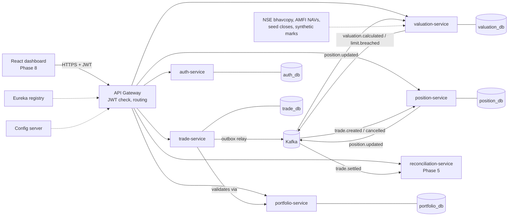

# AlphaLedger

**Portfolio management and trade reconciliation platform for Indian markets.** An event-driven Java / Spring Boot
microservices system: trades flow in, positions and portfolio value update from events, and settled trades are
reconciled against a custodian file, with mismatches ("breaks") worked through a dashboard.

Built as an interview-ready portfolio project for a technology role in asset management. It mirrors the three things
an asset manager must do every day: **record trades, know what it holds and what that is worth, and prove its records
match the custodian's.**

 
 
 

---

## Contents
- [What it does](#what-it-does)
- [Project status](#project-status)
- [Architecture](#architecture)
- [Tech stack](#tech-stack)
- [Data: real prices, synthetic transactions](#data-real-prices-synthetic-transactions)
- [Running locally](#running-locally)
- [Trying the API](#trying-the-api)
- [Testing](#testing)
- [Repository layout](#repository-layout)
- [Key design decisions](#key-design-decisions)
- [Documentation](#documentation)
- [License and data](#license-and-data)

---

## What it does

| Area | What the platform does | Status |
|---|---|---|
| **Security** | Email/password login, short-lived JWT access tokens with rotating refresh tokens, four roles (Admin, Portfolio Manager, Operations Analyst, Auditor), checks at the gateway and again in every service | ✅ Built |
| **Portfolios & instruments** | Portfolios split into funds by asset class (Private Equity, Credit, Real Estate); instruments keyed by **ISIN** with check-digit validation; a PM changes only the portfolios they manage | ✅ Built |
| **Trade capture** | BUY/SELL trades in INR with **T+1 settlement on NSE business days**, a status lifecycle (NEW → VALIDATED → SETTLED, REJECTED, CANCELLED), a full audit trail, idempotent trade references, CSV bulk upload, automatic settlement | ✅ Built |
| **Events** | Every change is published to **Kafka** through a transactional outbox: `trade.*`, `position.updated`, `price.updated`, `valuation.calculated`, `limit.breached`; consumers are idempotent | ✅ Built |
| **Market data** | Pluggable price sources; **real NSE and AMFI closing prices** for listed instruments and mutual funds, synthetic Level 3 marks for private holdings; every price shows its source, date and whether it is stale | 🟨 Foundation built; live NSE/AMFI downloads later |
| **Positions & valuation** | Holdings and weighted-average cost rebuilt from trade events (exact cancels, realized P&L); live Market Value, unrealized P&L and exposure by asset class and instrument, every line with its price source; end-of-day snapshots and asset-class limits with breach alerts. Full NAV (cash and liabilities) in v1.5 | ✅ Built |
| **Reconciliation** (signature feature) | Match a custodian file to settled trades on `trade ref + ISIN + trade date`; detect missing, quantity and price breaks; assign, resolve and escalate with an audit trail | ⬜ Planned |
| **Notifications & resilience** | Alerts for breaks and limit breaches; retries, dead-letter topics, circuit breakers | ⬜ Planned |
| **Analytics** | Warehouse-style star schema, data-quality checks, AUM and break-trend views | ⬜ Planned |
| **Dashboard** | React UI for PMs and Operations Analysts | ⬜ Planned |

**Personas** (demo users): Priya (Portfolio Manager), Rohan (Operations Analyst), Anita (Admin), Vikram (Auditor).

---

## Project status

| Phase | Scope | Status |
|---|---|---|
| 0 | Planning, docs, repo, tooling | ✅ |
| 1 | Monorepo, Docker infrastructure, gateway, service registry, config server | ✅ |
| 2 | Authentication, roles, portfolios, instruments | ✅ |
| 3 | Trade capture, lifecycle, outbox, Kafka events | ✅ |
| 4A | Market data: price sources, NSE holiday calendar, T+1 | 🟨 Foundation done; live adapters after Phase 5 |
| 4 | Positions and valuation (market value, P&L, exposure, limits) | ✅ |
| 4B | NAV extension (cash, liabilities) | ⬜ Next |
| 5 | Reconciliation engine | ⬜ |
| 6 | Notifications and resilience | ⬜ |
| 7 | Data engineering and analytics | ⬜ |
| 8 | React frontend | ⬜ |
| 9 | CI/CD, quality gates, observability | ⬜ |
| 10 | Polish, docs, demo | ⬜ |

Detailed checklists and a progress log: [docs/roadmap.md](docs/roadmap.md).

---

## Architecture

Each service owns its database, exposes REST through one gateway, and talks to the others through Kafka events.



| Service | Port | Responsibility | Status |
|---|---|---|---|
| `api-gateway` | 8080 | Routing, JWT validation, CORS, correlation IDs, spoof-proof user headers | ✅ |
| `discovery-server` | 8761 | Eureka service registry | ✅ |
| `config-server` | 8888 | Shared configuration | ✅ |
| `auth-service` | 8081 | Users, roles, login, token refresh and revocation | ✅ |
| `portfolio-service` | 8082 | Portfolios, funds, instrument master | ✅ |
| `trade-service` | 8083 | Trade capture, validation, lifecycle, settlement, outbox | ✅ |
| `valuation-service` | 8085 | Prices (source badges), Market Value, P&L, exposure, limits, end-of-day snapshots; NAV in v1.5 | ✅ |
| `position-service` | 8084 | Holdings, weighted-average cost, realized P&L, daily snapshots | ✅ |
| `reconciliation-service` | 8086 | Custodian file ingest, matching, breaks | Skeleton |
| `notification-service` | 8087 | In-app and email notifications | Skeleton |
| `analytics-service` | 8088 | Analytics ETL and reporting APIs | Skeleton |

**Reliability patterns already in place:** transactional outbox (a trade and its event commit together), at-least-once
delivery with correlation IDs on every request and event, idempotent trade creation, database row locking
(`FOR UPDATE SKIP LOCKED`) so several instances can relay events or settle trades safely, and a PostgreSQL advisory
lock so two simultaneous SELLs cannot both pass the holding check. Daily position and valuation snapshots run as
**Spring Batch** jobs (one recorded run per date).

Full design: [docs/architecture.md](docs/architecture.md). Event formats: [docs/events.md](docs/events.md).

---

## Tech stack

| Layer | Technology |
|---|---|
| Language | Java 21 (LTS) |
| Framework | Spring Boot 4.0, Spring Cloud 2025.1 (Gateway, Eureka, Config) |
| Security | Spring Security 7 (OAuth2 resource server), JWT (HS256, Nimbus JOSE), BCrypt |
| Messaging | Apache Kafka 4.2 (KRaft), Spring Kafka, transactional outbox |
| Data | PostgreSQL 16 (one database per service), Spring Data JPA / JDBC, Flyway |
| API docs | springdoc-openapi (Swagger UI on every service) |
| Testing | JUnit 5, AssertJ, Mockito, MockMvc, Testcontainers (real Postgres and Kafka) |
| Build & run | Maven Wrapper (multi-module), Docker multi-stage builds, Docker Compose |
| Batch | Spring Batch 6 (end-of-day valuation and position snapshots) |
| Planned | React 18 + TypeScript, Prometheus/Grafana, GitHub Actions, SonarCloud |

---

## Data: real prices, synthetic transactions

AlphaLedger targets **Indian markets**: base currency **INR**, instruments identified by **ISIN**, and **T+1**
settlement that skips weekends and **NSE trading holidays** (a Monday 19-Oct-2026 trade settles on Wednesday, because
Tuesday is Dussehra).

- **Real public data** for prices and reference data. The demo universe is 26 real instruments:
  - **Real Estate:** listed REITs and InvITs
  - **Credit:** G-secs, NCDs and debt mutual funds
  - **Private Equity proxies:** listed equities and equity mutual funds

  Their ISINs were checked against the NSE and AMFI files. The demo prices are the **14-Oct-2026 closes** from NSE's
  daily bhavcopy and AMFI's NAV file, committed as a small hand-filtered seed with the source recorded on every row.
- **3 clearly labelled synthetic private companies** (identifier prefix `ZZSYN`), valued by invented quarterly marks
  (fair-value Level 3), since real private holdings have no public prices.
- **Synthetic** trades, positions, custodian files and reconciliation breaks: real ones are private, and reconciliation
  needs deliberately injected breaks to prove the matching engine.

Every price carries its **source** (e.g. `NSE_BHAVCOPY`, `AMFI_NAV`, `SYNTHETIC`) and **data date**, and is flagged
**stale** when it is older than the latest business day. A synthetic price is never used in place of a missing real
one.

---

## Running locally

Requires **JDK 21** and **Docker Desktop**. Maven is not needed: the Maven Wrapper downloads it.

```bash
./mvnw verify                                             # build all modules and run all tests
docker compose -f infra/docker-compose.yml up -d --build  # start the stack (first build takes a few minutes)
bash scripts/smoke-test.sh                                # 38 end-to-end checks through the gateway
bash scripts/demo-trades.sh                               # optional: 20 demo trades at real 14-Oct-2026 closes
docker compose -f infra/docker-compose.yml down           # stop (add -v to also delete the Postgres data)
```

The stack runs fully offline. Settings (database password, JWT signing key, demo password) can be overridden by
copying `infra/.env.example` to `infra/.env`. The full stack (12 containers) uses about 4.5 GB of memory.

| URL | What |
|---|---|
| http://localhost:8080 | API gateway: every `/api/v1/...` call |
| http://localhost:8761 | Eureka dashboard (registered services) |
| http://localhost:8090 | Kafka UI (topics and messages) |
| http://localhost:8025 | MailHog (captured emails) |
| http://localhost:8081/swagger-ui.html | auth-service API docs |
| http://localhost:8082/swagger-ui.html | portfolio-service API docs |
| http://localhost:8083/swagger-ui.html | trade-service API docs |
| http://localhost:8084/swagger-ui.html | position-service API docs |
| http://localhost:8085/swagger-ui.html | valuation-service API docs |

### Demo users

All four share the local demo password `Demo@AlphaLedger2026`.

| Email | Role | Can |
|---|---|---|
| `anita.admin@alphaledger.test` | ADMIN | Everything, including user management, manual settlement and price uploads |
| `priya.pm@alphaledger.test` | PM | Manage her portfolios (the 3 demo portfolios), capture and cancel trades, add instruments |
| `rohan.ops@alphaledger.test` | OPS_ANALYST | Read portfolios, trades and prices (reconciliation from Phase 5) |
| `vikram.auditor@alphaledger.test` | AUDITOR | Read only |

Demo portfolios (managed by Priya): *AlphaLedger India Credit Opportunities Fund I*, *AlphaLedger Bharat Real Assets
Fund*, *AlphaLedger India Growth Equity Fund*.

---

## Trying the API

The easiest route is Postman: import `docs/postman/AlphaLedger.postman_collection.json`, run a **Login as ...**
request (it stores the token), then try the Portfolios, Instruments, Trades and Market data folders. With curl:

```bash
# 1. Log in as Priya (PM) and keep the access token
TOKEN=$(curl -s -X POST localhost:8080/api/v1/auth/login -H 'Content-Type: application/json' \
  -d '{"email":"priya.pm@alphaledger.test","password":"Demo@AlphaLedger2026"}' | sed -n 's/.*"accessToken":"\([^"]*\)".*/\1/p')

# 2. Her portfolios and the instrument master
curl -s -H "Authorization: Bearer $TOKEN" localhost:8080/api/v1/portfolios
curl -s -H "Authorization: Bearer $TOKEN" "localhost:8080/api/v1/instruments?assetClass=REAL_ESTATE"

# 3. Buy 500 units of Embassy Office Parks REIT for the Bharat Real Assets Fund (portfolio 2).
#    Trade date defaults to today, settle date to T+1 business day.
curl -s -X POST localhost:8080/api/v1/trades -H "Authorization: Bearer $TOKEN" -H 'Content-Type: application/json' \
  -d '{"portfolioId":2,"isin":"INE041025011","side":"BUY","quantity":500,"price":435.00}'

# 4. Its latest price, with source, data date and staleness
curl -s -H "Authorization: Bearer $TOKEN" "localhost:8080/api/v1/marketdata/prices/latest?isin=INE041025011"

# 5. A few seconds later (trade -> Kafka -> position -> Kafka -> valuation): holdings, Market Value and exposure
curl -s -H "Authorization: Bearer $TOKEN" localhost:8080/api/v1/portfolios/2/positions
curl -s -H "Authorization: Bearer $TOKEN" localhost:8080/api/v1/portfolios/2/valuation
curl -s -H "Authorization: Bearer $TOKEN" localhost:8080/api/v1/portfolios/2/exposure
```

The valuation is labelled **Market Value** with `valuationBasis: MARKET_VALUE_ONLY` and `nav: null`: true NAV needs
cash and liabilities, which arrive in v1.5. Run `bash scripts/demo-trades.sh` to fill all three demo portfolios.

Things worth trying:
- **Rejection:** SELL more than you hold. The trade is stored as REJECTED with a reason.
- **Roles:** create a portfolio as Vikram (auditor). You get 403.
- **Events:** open Kafka UI, topic `trade.created`, to see the event for your trade.
- **Audit trail:** open `/api/v1/trades/{id}/audit` for any trade.

In Swagger, log in with `POST /api/v1/auth/login`, then paste the `accessToken` into **Authorize**.

---

## Testing

| Level | What | Tools |
|---|---|---|
| Unit | Trade state machine, T+1 and holiday rules, holding checks, position math (average cost, realized P&L, exact cancels), valuation and exposure (three hand-calculated scenarios), token issuing and rotation, ISIN check digits, price validation and the synthetic-price rule | JUnit 5, AssertJ, Mockito |
| Integration (`*IT`) | Each service end to end against real PostgreSQL and Kafka: migrations, security, idempotency, duplicate events, events on the topics, Spring Batch runs | Spring Boot Test, MockMvc, Testcontainers |
| Smoke | 38 checks against the running Docker stack through the gateway: health, registration, login per role, 401/403 cases, trade capture, Kafka event, prices, holidays, trade → position → valuation | `scripts/smoke-test.sh` |

Currently **170 automated tests**, all passing (`./mvnw verify`; integration tests need Docker running).

---

## Repository layout

| Path | Contents |
|---|---|
| `common/` | Shared library: event envelope and topics, error model, correlation IDs, JWT security, ISIN validation, business-day calendar |
| `services/` | Spring Boot services: platform (`discovery-server`, `config-server`, `api-gateway`) and business services |
| `reference-data/` | Committed reference data: instrument master (stable IDs), NSE holidays, synthetic marks, seed closes |
| `infra/` | Docker Compose stack, shared service Dockerfile, Postgres init, `.env.example` |
| `scripts/` | Smoke test, demo trade loader |
| `docs/` | PRD, architecture, roadmap, events, conventions, Postman collection |
| `frontend/` | React dashboard (Phase 8) |

---

## Key design decisions

Recorded as ADRs in [docs/architecture.md](docs/architecture.md) §13. Highlights:

| Decision | Why |
|---|---|
| Microservices with a database per service, Kafka between them | Mirrors real asset-management platforms; services evolve and scale independently |
| Transactional outbox for events | A trade and its event commit atomically, so no event is lost and none is sent for a rolled-back trade |
| v1 reports **Market Value**; full **NAV** comes in v1.5 | NAV needs cash and liabilities; calling market value "NAV" would be wrong |
| Real public prices, synthetic transactions | Credible valuations with real data, while trade and custodian data stays synthetic |
| Rejected trades are stored, not just refused | The blotter and audit trail show every attempted trade, as in real trade capture |
| Positions rebuilt from all their trades on every event | Cancels are exact even after later trades, and a duplicate event can never double-count |
| Spring Boot 4 and Java 21 | The currently supported Spring line and Java LTS |
| HS256 JWTs checked at the gateway and in every service | Simple to run locally, and a service reached directly still rejects forged tokens |

---

## Documentation

| Document | What it covers |
|---|---|
| [Product requirements](docs/prd.md) | Goals, personas, functional requirements, business rules, demo data plan |
| [Architecture](docs/architecture.md) | Services, events, data pipelines, data model, APIs, security, ADRs |
| [Roadmap](docs/roadmap.md) | Phase checklists, definitions of done, progress log |
| [Event schemas](docs/events.md) | Kafka envelope; trade, position, price, valuation and limit events |
| [Conventions](docs/conventions.md) | Branching, commits, naming for packages, topics, endpoints, tables |

---

## License and data

Code: [MIT](LICENSE). This is a personal, non-commercial portfolio project. Market data comes from public sources
(NSE, AMFI) and stays subject to their terms. The repository contains only a small hand-filtered sample, never raw
data dumps. All trades, positions, custodian files and the 3 `ZZSYN` instruments are synthetic.
