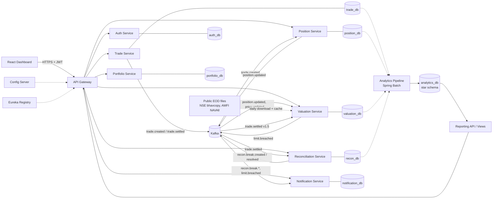
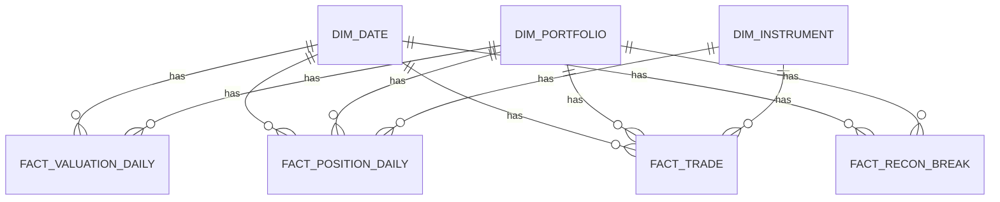
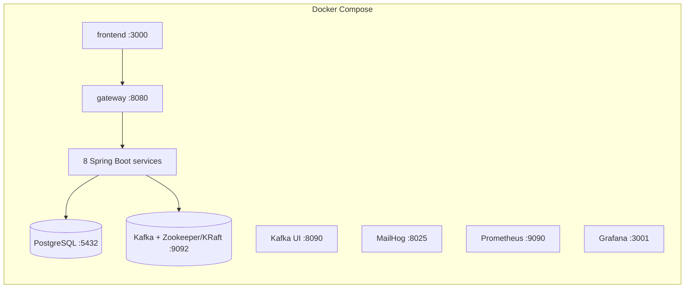
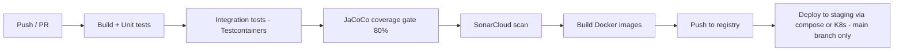

# AlphaLedger: System Architecture, Tech Stack & Data Pipelines

> Companion to `prd.md`. This document describes **how** AlphaLedger is built.

---

## 1. Architecture Overview

AlphaLedger is an **event-driven microservices system**. Each service owns its data (database-per-service), exposes REST APIs through a single gateway, and communicates asynchronously through Kafka.

### 1.1 Architectural principles
1. **Database per service**: no shared tables across services.
2. **Async by default**: services communicate via Kafka events; synchronous REST only for queries through the gateway.
3. **Idempotent consumers**: every consumer tolerates duplicate and out-of-order delivery.
4. **Outbox pattern**: state change and event publication happen atomically.
5. **Stateless services**: horizontally scalable; session state lives in JWTs.
6. **Everything containerized**: one command runs the whole stack.
7. **Observability first**: correlation IDs, health checks, and metrics from day one.

### 1.2 High-level system diagram



---

## 2. Service Catalog

| # | Service | Port | Responsibility | Database | Publishes | Consumes |
|---|---|---|---|---|---|---|
| 1 | **api-gateway** | 8080 | Routing, JWT validation, CORS, rate limiting | none | none | none |
| 2 | **discovery-server** (Eureka) | 8761 | Service registry | none | none | none |
| 3 | **config-server** | 8888 | Central configuration | Git/file | none | none |
| 4 | **auth-service** | 8081 | Users, roles, JWT issue/refresh | `auth_db` | none | none |
| 5 | **portfolio-service** | 8082 | Portfolios, funds, instruments | `portfolio_db` | none | none |
| 6 | **trade-service** | 8083 | Trade capture, validation, lifecycle | `trade_db` | `trade.created`, `trade.settled`, `trade.cancelled` | none |
| 7 | **position-service** | 8084 | Holdings, average cost, realized P&L | `position_db` | `position.updated` | `trade.created`, `trade.cancelled` |
| 8 | **valuation-service** | 8085 | Price ingestion (`PriceSource` adapters, holiday calendar), market value, cash and liabilities, NAV (v1.5), exposure, limits | `valuation_db` | `price.updated`, `limit.breached`, `valuation.calculated` | `position.updated`, `price.updated`, `trade.settled` (v1.5) |
| 9 | **reconciliation-service** | 8086 | File ingest, matching, break management | `recon_db` | `recon.break.created`, `recon.break.resolved` | `trade.settled` |
| 10 | **notification-service** | 8087 | In-app and email notifications | `notification_db` | none | `recon.break.*`, `limit.breached` |
| 11 | **analytics-service** | 8088 | ETL pipelines, analytics APIs | `analytics_db` | none | reads source data / Kafka |
| 12 | **frontend** (React) | 3000 | Dashboard UI | none | none | none |

### 2.1 Service internal structure (standard for all Spring Boot services)

```
src/main/java/com/alphaledger/<service>/
├── controller/     # REST controllers (thin)
├── service/        # Business logic
├── repository/     # Spring Data JPA repositories
├── domain/         # JPA entities and domain objects
├── dto/            # Request/response objects
├── mapper/         # MapStruct mappers
├── event/          # Event classes, producers, consumers
├── config/         # Spring configuration (security, kafka, etc.)
├── exception/      # Custom exceptions + global handler
└── util/
```

---

## 3. Tech Stack

### 3.1 Backend
| Concern | Technology |
|---|---|
| Language | Java 21 (LTS); Docker base image `eclipse-temurin:21-jre` |
| Framework | Spring Boot 4.0.x (currently 4.0.8) with Spring Cloud 2025.1.x (currently 2025.1.3) |
| Microservices | Spring Cloud (Gateway, Netflix Eureka, Config Server, OpenFeign if needed) |
| Persistence | Spring Data JPA / Hibernate, Flyway migrations |
| Batch | Spring Batch (reconciliation + ETL + price file ingestion) |
| HTTP client (market data) | Spring `RestClient` for file downloads and mfapi.in, wrapped in Resilience4j retry/rate limiter; disabled in tests and CI |
| Security | Spring Security 7 (OAuth2 resource server), JWT signed and verified with Nimbus JOSE (HS256), BCrypt |
| Messaging | Apache Kafka with Spring Kafka |
| Resilience | Resilience4j (retry, circuit breaker, rate limiter) |
| Mapping/Boilerplate | MapStruct, Lombok |
| API docs | springdoc-openapi (Swagger UI) |
| Build | Maven 3.9 via the Maven Wrapper (`./mvnw`), multi-module parent POM |

### 3.2 Data layer
| Concern | Technology |
|---|---|
| Operational DB | PostgreSQL 15+ (one logical DB per service) |
| Analytics DB | PostgreSQL analytics schema (Snowflake-style star schema); optional Snowflake/DuckDB |
| Caching (optional) | Redis (latest prices, hot reads) |
| Schema management | Flyway |
| Market data files | NSE CM bhavcopy (CSV in ZIP), AMFI `NAVAll.txt`; raw files cached on local disk with SHA-256 checksums; committed filtered sample for offline use |
| Streaming (stretch) | Apache Flink or Spark Structured Streaming |

### 3.3 Frontend
| Concern | Technology |
|---|---|
| Framework | React 18 + Vite |
| Language | TypeScript (recommended) or JavaScript |
| UI | Material UI or Ant Design |
| Charts | Recharts |
| Data fetching | Axios + React Query |
| Routing/State | React Router, Context or Redux Toolkit |
| Testing | Vitest + React Testing Library |

### 3.4 DevOps & Quality
| Concern | Technology |
|---|---|
| Containers | Docker (multi-stage builds), Docker Compose |
| CI/CD | GitHub Actions (alternative: Jenkins) |
| Registry | GitHub Container Registry / Docker Hub |
| Orchestration (stretch) | Kubernetes (minikube/kind), Helm |
| Cloud (stretch) | AWS (ECS/EKS + RDS + MSK) or Azure equivalents |
| Code quality | SonarQube/SonarCloud, Checkstyle, SpotBugs |
| Coverage | JaCoCo (80% gate) |
| Unit testing | JUnit 5, Mockito, AssertJ |
| Integration testing | Testcontainers (Postgres, Kafka), Spring Boot Test |
| API testing | Postman collection / REST Assured |
| Observability | Spring Actuator, Micrometer, Prometheus, Grafana, Loki or ELK (stretch), OpenTelemetry (stretch) |
| Local tooling | Kafka UI (provectus), pgAdmin, MailHog |

---

## 4. Event-Driven Design

### 4.1 Kafka topics

| Topic | Producer | Consumers | Key | Partitions | Retention |
|---|---|---|---|---|---|
| `trade.created` | trade-service | position-service | `portfolioId` | 3 | 7d |
| `trade.settled` | trade-service | reconciliation-service, valuation-service (v1.5, cash) | `portfolioId` | 3 | 7d |
| `trade.cancelled` | trade-service | position-service | `portfolioId` | 3 | 7d |
| `position.updated` | position-service | valuation-service, analytics | `portfolioId` | 3 | 7d |
| `price.updated` | valuation-service (`PriceSource` ingestion) | valuation-service | `instrumentId` | 3 | 3d |
| `valuation.calculated` | valuation-service | analytics, notification | `portfolioId` | 3 | 7d |
| `limit.breached` | valuation-service | notification-service | `portfolioId` | 1 | 7d |
| `recon.break.created` | reconciliation-service | notification-service, analytics | `runId` | 3 | 14d |
| `recon.break.resolved` | reconciliation-service | analytics | `breakId` | 3 | 14d |
| `*.DLT` | Spring Kafka error handler | ops/manual replay | original key | 1 | 30d |

**Keying by `portfolioId`** guarantees ordering of events for the same portfolio, which is critical for correct position math.

### 4.2 Event envelope (all events)

```json
{
  "eventId": "uuid",
  "eventType": "TRADE_CREATED",
  "eventVersion": 1,
  "occurredAt": "2026-10-15T09:30:00Z",
  "correlationId": "uuid",
  "producer": "trade-service",
  "payload": { }
}
```

### 4.3 Sample payload: `trade.created`

```json
{
  "tradeId": 1001,
  "tradeRef": "TRD-20261019-0001",
  "portfolioId": 1,
  "instrumentId": 42,
  "isin": "INE041025011",
  "side": "BUY",
  "quantity": 500,
  "price": 435.00,
  "currency": "INR",
  "tradeDate": "2026-10-19",
  "settleDate": "2026-10-21"
}
```

`settleDate` is T+1 business day: Tue 20-Oct-2026 is an NSE trading holiday (Dussehra), so a Monday trade settles on Wednesday. `isin` is carried on the event so downstream services (reconciliation, analytics) do not need to call portfolio-service. `instrumentId` is identical in every service because all of them are seeded from the `instrument_id` column of the instrument master (§5.8); `isin` is the fallback join key if an ID is ever missing or mismatched.

### 4.4 Reliability patterns
| Pattern | Where | How |
|---|---|---|
| **Transactional Outbox** | trade-service, reconciliation-service | Write business row + `outbox_event` row in one DB transaction; a poller/relay publishes to Kafka and marks sent. |
| **Idempotent consumer** | position-service, valuation-service, notification-service | `processed_event(event_id)` table checked before processing. |
| **Retry with backoff** | all consumers | Spring Kafka `DefaultErrorHandler` with exponential backoff (default 3 retries: 0.5 s, 1 s, 2 s; `alphaledger.kafka.retry.*`). Unreadable records (bad JSON, missing payload) skip the retries. |
| **Dead-letter topic** | all consumers | After the retries, the record goes to `<topic>.DLT` (same key; exception in `kafka_dlt-*` headers) and the consumer moves on, so one bad record never blocks a partition. Admin lists and replays them with `GET/POST /api/v1/ops/dead-letters/{topic}[/replay]` (replay progress is a consumer group, so each record is replayed once). |
| **Circuit breaker** | gateway → services; trade-service → portfolio-service | Gateway: one Resilience4j breaker per route (opens at 50% failures over the last 20 calls, open 10 s, 30 s time limit) with a JSON 503 fallback; GET requests retried twice. trade-service: retry (3 attempts) inside a breaker; 4xx answers are neither retried nor counted. |
| **Rate limiting** | gateway | In-memory token bucket per user (or IP before login): burst 100, 20/s; 429 with `Retry-After`. Per gateway instance; several instances would need a shared store such as Redis. |
| **Correlation ID** | HTTP and Kafka | Gateway sets `X-Correlation-Id`; services log it (MDC) and forward it on REST calls; the outbox relay puts it in a Kafka header; a record interceptor puts it back in the consumer's MDC. |
| **Ordering** | per portfolio | Partition key = `portfolioId`. |

All Kafka consumer resilience lives in `common` (`KafkaResilienceAutoConfiguration`) and switches on in any service that sets `spring.kafka.consumer.group-id`.

---

## 5. Data Engineering Pipelines

AlphaLedger has five pipelines. Together they form the "data engineering" story.

### 5.1 Pipeline overview

```mermaid
flowchart TB
    subgraph P1[Pipeline 1: Trade to Position stream]
        A1[Trade API] --> A2[(trade_db + outbox)] --> A3[Kafka trade.created] --> A4[Position consumer] --> A5[(position_db)] --> A6[Kafka position.updated]
    end
    subgraph P2[Pipeline 2: Price ingestion]
        B0[PriceSource adapters<br/>NSE bhavcopy / AMFI NAV / mfapi / synthetic / CSV] --> B1[File cache + checksum<br/>price_ingestion_log] --> B2[Validate + dedupe] --> B3[(price table<br/>source + data_date)] --> B4[Kafka price.updated]
    end
    subgraph P3[Pipeline 3: Valuation - market value, NAV from v1.5]
        C1[position.updated + price.updated] --> C2[Market value calc] --> C3[P&L / exposure / NAV from v1.5] --> C4[(valuation_snapshot)]
    end
    subgraph P4[Pipeline 4: Reconciliation batch]
        D1[Custodian CSV] --> D2[Parse + validate] --> D3[Match engine] --> D4[(recon_break)] --> D5[Kafka recon.break.created]
    end
    subgraph P5[Pipeline 5: Analytics ETL]
        E1[Source DBs + Kafka] --> E2[Extract] --> E3[Transform + DQ checks] --> E4[(analytics_db star schema)] --> E5[Analytical views]
    end
```



### 5.2 Pipeline 1: Trade-to-Position streaming pipeline
- **Type:** Real-time, event-driven.
- **Flow:** Trade API → validate → save trade + outbox row (one transaction) → outbox relay publishes `trade.created` → Position consumer → update position → publish `position.updated`.
- **Guarantees:** At-least-once delivery, exactly-once effect via `processed_event` dedupe.
- **Failure handling:** 3 retries with backoff, then `trade.created.DLT`. Failed events can be replayed after a fix.
- **Edge cases:** SELL exceeding holdings → rejection event; out-of-order events handled by partition keying.

### 5.3 Pipeline 2: Price ingestion pipeline
- **Type:** Scheduled batch, daily after the end-of-day files are published, in both modes (`LIVE` downloads the files; `OFFLINE` reads the committed sample). In `OFFLINE` mode only, a micro-batch every minute adds synthetic intraday demo ticks. Also triggered manually (CSV upload, backfill).
- **Source:** a pluggable `PriceSource` adapter (below) selected by configuration, or an uploaded CSV. The mock random-walk generator is no longer the default; it lives on as `SyntheticPriceSource`. Source formats are in §5.8.

**`PriceSource` interface** (valuation-service, package `marketdata`):

```java
public interface PriceSource {
    String name();                                   // "NSE_BHAVCOPY", "AMFI_NAV", "MFAPI", "SYNTHETIC", "CSV_UPLOAD"
    boolean supports(InstrumentRef instrument);      // e.g. by instrument_type
    PriceBatch fetch(LocalDate dataDate, Collection<InstrumentRef> instruments);
    // PriceBatch = raw file reference (path + SHA-256) + parsed PriceRecord rows + rejected rows with reasons
}
```

| Implementation | Covers | Fetch mode | Role |
|---|---|---|---|
| `NseBhavcopyPriceSource` | `EQUITY`, `REIT`, `INVIT`, `GSEC`, `BOND` | `HTTP` (NSE archives) or `LOCAL_DIR` | Primary for listed instruments |
| `AmfiNavPriceSource` | `MUTUAL_FUND` | `HTTP` (AMFI) or `LOCAL_DIR`; Spring Batch job (reader → processor → writer) | Primary for mutual funds |
| `MfApiPriceSource` | `MUTUAL_FUND` | `HTTP` (mfapi.in JSON) | Fallback for missing NAVs and history backfill only; never required |
| `SyntheticPriceSource` | Only `is_synthetic = true` instruments, plus demo intraday ticks in `OFFLINE` mode | In-process (committed quarterly marks for synthetic private instruments; seeded random walk for `OFFLINE` intraday ticks) | Offline/demo/test |
| `CsvUploadPriceSource` (implemented as `CsvPriceFile`, an upload parser rather than a scheduled source) | All real instruments | Manual upload (`POST /api/v1/marketdata/prices/upload`, Admin); rows may declare a real provenance (`NSE_BHAVCOPY`, `AMFI_NAV`, `YFINANCE`), never `SYNTHETIC` | Manual override; also loads the committed seed closes |

yfinance (`.NS` / `.BO` tickers) is **not** an automated adapter: it is unofficial and Python-only. As a last resort, `scripts/market-data/yf_fallback.py` (stretch) can write a CSV that is loaded through `CsvUploadPriceSource` with `source = YFINANCE`.

**Selection and fallback (configuration):**

```yaml
alphaledger:
  marketdata:
    mode: OFFLINE                  # OFFLINE (default for local demo, tests, CI) | LIVE
    network-enabled: false         # hard guard: HTTP fetch modes throw if false
    sample-enabled: true           # OFFLINE: parse the committed sample (reference-data/sample/nse|amfi) on startup
    cache-dir: data/market-cache   # LIVE: raw files, {source}/{yyyy}/{file}; git-ignored
    nse-download: false            # NSE terms prohibit automated collection: bhavcopies are saved here by hand
    max-staleness-business-days: 5 # DQ warning threshold; any price older than its expected date is already flagged stale
    fallback-order:
      EQUITY:      [NSE_BHAVCOPY]
      REIT:        [NSE_BHAVCOPY]
      INVIT:       [NSE_BHAVCOPY]
      GSEC:        [NSE_BHAVCOPY]
      BOND:        [NSE_BHAVCOPY]
      MUTUAL_FUND: [AMFI_NAV, MFAPI]
      PRIVATE:     [SYNTHETIC]         # only is_synthetic = true instruments
```

- For each instrument and data date, sources are tried in order; a later source only fills instruments the earlier ones did not price. One price per instrument per data date per source is stored, and valuation reads the most recent price, breaking ties by the configured order.
- In `OFFLINE` mode, `NseBhavcopyPriceSource` and `AmfiNavPriceSource` read the committed sample files from the classpath (`reference-data/sample/nse|amfi`, so the real parsers still run). In `LIVE` mode they read `cache-dir`: AMFI's NAVAll.txt is downloaded into it when missing; NSE bhavcopies are saved there by hand (automatic NSE download is off, see §5.8 and ADR 22). `MfApiPriceSource` runs only in `LIVE` mode with the network on.
- **As built (Phase 4A):** a source that has no file for the date (holiday, not published, not in the sample) is logged as a `FAILED` ingestion with the reason and writes nothing. `POST /api/v1/marketdata/ingestions` runs the daily fallback or one source for a date; `POST /api/v1/marketdata/ingestions/backfill` repeats it for each business day of a range (at most 31 days, Admin only); both are idempotent by checksum. All market-data HTTP goes through one guarded client (`MarketDataHttp`), and the test JVMs route every non-local HTTP(S) request to a dead proxy, so a test that tried to reach the internet would fail.
- `SYNTHETIC` prices only instruments with `is_synthetic = true`, plus demo intraday ticks in `OFFLINE` mode. It never appears in the fallback list of a real instrument type.
- If no real source prices a real instrument, no price is written and a synthetic price is **never** substituted: the last real price is kept and flagged stale, alongside its `data_date`. Gaps are expected for thinly traded bonds.
- **Staleness rule (one definition everywhere):** a price is stale when its `data_date` is earlier than the expected price date, which is the most recent business day (per `holiday_calendar`) on or before the valuation date; for `is_synthetic` instruments it is the most recent quarter-end. When a stale price is older than `max-staleness-business-days`, a data-quality warning is also raised.
- Every price shown in the UI carries a source badge (`source` + `data_date`), so real, fallback, synthetic, and stale prices are always distinguishable.

- **Steps** (validate/dedupe/load/publish are unchanged in purpose):
  1. **Extract:** the adapter downloads (or reads locally) the raw file into `cache-dir/{source}/{yyyy}/{file}` and computes its SHA-256. If `price_ingestion_log` already has `(source, file_checksum)` with status `SUCCESS`, the run stops with status `SKIPPED_DUPLICATE` (idempotent re-ingestion). The file is then parsed by the source's isolated parser, which checks the header against the expected columns first and fails the whole file on a mismatch.
  2. **Validate:** price > 0, ISIN maps to a known `instrument_ref` (unknown ISINs are skipped silently, since source files cover the whole market), `data_date` is a business day per `holiday_calendar` and not in the future. Rejected rows for known instruments go to `price_ingestion_error` with a reason.
  3. **Deduplicate:** unique `(instrument_id, data_date, source)` for real sources (one end-of-day price per instrument, date, and source); unique `(instrument_id, as_of_timestamp, source)` only for `SYNTHETIC` rows (intraday ticks and quarterly marks).
  4. **Load:** upsert into `price` with `source`, `data_date`, and `ingestion_id`; write row counts and status to `price_ingestion_log`.
  5. **Publish:** `price.updated` for changed instruments.

### 5.4 Pipeline 3: Valuation & NAV pipeline
- **Type:** Hybrid: event-triggered (intraday) + scheduled batch (end-of-day official valuation).
- **Intraday:** `position.updated` keeps valuation-service's copy of holdings current; the valuation endpoints compute market value live from those holdings and the latest prices on each request (cheap at this scale, always current, nothing to invalidate).
- **End-of-day (Spring Batch job, runs after that business day's price ingestion completes; 18:00 daily in `OFFLINE` mode):**
  1. Read all positions.
  2. Join with closing prices.
  3. Compute market value, unrealized P&L, exposure by asset class.
  4. **(v1.5)** Read `cash_balance` and open `liability` rows; compute `NAV = market value + cash − liabilities`.
  5. Write immutable `valuation_snapshot` (with components, P&L and `valuation_basis`) and `exposure_snapshot`; one run per date (Spring Batch job `valuationSnapshotJob`).
  6. Publish `valuation.calculated`.
- **Limit check:** compare exposure % against `limit_rule`; publish `limit.breached` when over threshold.

### 5.4a Valuation model: Market Value (v1) vs NAV (v1.5)

| | v1: Portfolio Market Value | v1.5: NAV |
|---|---|---|
| Formula | Σ (quantity × latest price) | Market value + cash + other assets − liabilities |
| Inputs | `position`, `price` | adds `cash_balance`, `liability` |
| Stored as | `market_value`, `valuation_basis = MARKET_VALUE_ONLY`, `nav` left NULL | adds `cash_balance`, `total_liabilities`, `nav`, `valuation_basis = FULL_NAV` |
| Shown in UI as | "Market Value" | "NAV" |

**Scheme NAV vs portfolio NAV:** published mutual fund NAVs from AMFI are price **inputs** (rows in `price` with `source = AMFI_NAV`), used like closing prices. They do not turn the v1 metric into a NAV; only the v1.5 computation above produces the portfolio's NAV.

**Why the distinction matters:** a fund's NAV is total assets minus total liabilities. Assets include cash, receivables, and investments at fair value; liabilities include accrued fees and expenses, trade payables, borrowings, and redemptions payable. The v1 formula is a deliberate simplification and must not be labelled NAV.

**v1.5 cash and liability flow:**
- `trade.settled` (consumed by valuation-service): BUY reduces cash by `qty × price`; SELL increases cash.
- Daily accrual job, e.g. `management_fee_accrual = fee_rate × market_value / 365`, written to `liability`.
- `cash_transaction` is an append-only ledger; `cash_balance` is derived from it.

**As built (Phase 4B):**
- Ledger entry types: `DEPOSIT`, `WITHDRAWAL`, `TRADE_BUY`, `TRADE_SELL`, `BORROWING`, `LIABILITY_PAYMENT`. Amounts are signed. A database trigger refuses `UPDATE` and `DELETE`. Each entry has an `effective_date` (settle date for trades), so cash on any past date is rebuilt from the ledger.
- A settlement is recorded once per `tradeRef` (partial unique index), as well as once per `eventId`.
- Liabilities (`MANAGEMENT_FEE`, `EXPENSE`, `PAYABLE`, `BORROWING`) count from `accrual_date` until `paid_date`. Paying one takes its amount out of cash, so NAV does not change. Recording a borrowing brings its amount into cash. Borrowings cannot be deleted or have their amount changed; they are repaid.
- A withdrawal may not take cash below zero. A settled BUY may, because it is a fact (an overdraft).
- The fee accrual runs every calendar day at 23:40 IST, before the 23:45 end-of-day valuation, at `alphaledger.valuation.management-fee-rate` (default 1% a year). It writes one row per portfolio and day.
- Exposure and limits stay shares of **market value**, not NAV.
- Hand-checked scenarios: [nav-scenarios.md](nav-scenarios.md).

**Known limitations (documented, out of scope):** per-unit NAV, performance fee/carry waterfalls, capital calls and distributions, FX, and model-based valuation of illiquid holdings (fair-value levels L1/L2/L3).

### 5.5 Pipeline 4: Reconciliation batch pipeline (core)
- **Type:** Batch (Spring Batch), triggered by upload or schedule.
- **Steps:**

| Step | Description |
|---|---|
| 1. Ingest | Receive file; store raw copy; compute checksum (prevents duplicate runs). |
| 2. Parse | Read CSV rows in chunks (reader → processor → writer). |
| 3. Validate | Required fields, types, date formats. Bad rows → `custodian_record_error`. |
| 4. Stage | Load valid rows into `custodian_record` tied to `run_id`. |
| 5. Match | Join staged records with settled internal trades on `trade_ref + instrument + trade_date`, with the instrument keyed by ISIN (`trade_ref + isin + trade_date`). |
| 6. Compare | Check quantity (exact) and price (tolerance). |
| 7. Classify | Create breaks: `MISSING_INTERNAL`, `MISSING_EXTERNAL`, `QTY_MISMATCH`, `PRICE_MISMATCH`. |
| 8. Summarize | Write run summary (totals, matched, breaks per type, match rate). |
| 9. Publish | Emit `recon.break.created` per break (via outbox). |

- **Matching algorithm (simplified):**

```
internal  = settled trades for the date window, indexed by matchKey
external  = custodian records, indexed by matchKey

for key in external:
    if key not in internal            -> MISSING_INTERNAL
    elif qty differs                  -> QTY_MISMATCH
    elif |price diff| > tolerance     -> PRICE_MISMATCH
    else                              -> MATCHED
for key in internal not in external   -> MISSING_EXTERNAL
```

- **Match key and ISIN:** `matchKey = trade_ref + isin + trade_date`. Custodian files identify securities by ISIN, not by our internal `instrument_id` or the exchange symbol (symbols can change and differ between NSE and BSE). The ISIN comes from the `trade.settled` payload into `settled_trade_view`, so matching needs no call to portfolio-service. A custodian row whose ISIN is unknown is still staged and surfaces as `MISSING_INTERNAL`.
- **Performance:** hash-map matching, chunk size 500, batch inserts. Target is 10k records in under 30 s.
- **Idempotency:** file checksum + `(run_date, source)` unique constraint. Re-uploading the same file for the same date returns the existing run (HTTP 200) and creates nothing.
- **As built (Phase 5):** a Spring Batch job with two steps: `stageCustodianRecords` (reader over the stored file → `CustodianRowValidator` → batch writer, chunk 500) and `matchAndRaiseBreaks` (one transaction: engine run, breaks, `CREATED` audit rows, outbox events, run summary). Rows are rejected for a wrong column count, bad ISIN, unknown side, bad dates, non-positive numbers, `settle_date` not equal to the run date, or a duplicate match key in the file. Quantities are compared signed (SELL negative), so a side mismatch is a quantity break. A failed job marks the run `FAILED` with the error.
- **Break workflow:** `OPEN → IN_REVIEW` (assign) `→ ESCALATED` (escalate), and `IN_REVIEW`/`ESCALATED → RESOLVED` with `ACCEPT_EXTERNAL`, `ADJUST_INTERNAL` or `KNOWN_DIFFERENCE`. Every action needs a comment, locks the row and writes an immutable `break_action_audit` entry with before/after state. Resolved breaks are never reopened. Ageing: `age_days` and `overdue` (older than `alphaledger.recon.sla-days`, default 3).

### 5.6 Pipeline 5: Analytics ETL pipeline (data warehouse style)
- **Type:** Scheduled batch (nightly) plus optional Kafka-fed incremental loads.
- **Goal:** Produce analytics-ready tables for reporting, mimicking Snowflake-style modelling.
- **Layers:**

| Layer | Purpose | Example |
|---|---|---|
| **Raw / Staging** | Exact copy of source extracts | `stg_trade`, `stg_position`, `stg_break` |
| **Core (star schema)** | Cleaned, conformed dimensional model | `dim_*`, `fact_*` |
| **Marts / Views** | Business-ready aggregates | `vw_aum_by_asset_class`, `vw_daily_pnl`, `vw_break_trend`, `vw_break_ageing` |

- **Star schema:**



- **Data quality checks (run after load, fail loudly):**
  - Row-count reconciliation: source rows vs loaded rows.
  - Not-null on keys, uniqueness on grain.
  - Referential integrity (every fact row has a valid dimension row).
  - Sanity: market value ≥ 0 (NAV can legitimately be negative if liabilities exceed assets), quantity ≥ 0, no future dates.
  - Results stored in a `dq_check_result` table and surfaced in the dashboard.
- **As built (Phase 7):** Spring Batch job `analyticsEtlJob` (extract → load → data quality), nightly at 02:00 IST for the previous day, or on request. Extract reads each service's database through a read-only connection (ADR 23) into `staging.stg_*`; load is set-based SQL into `core.*` (dimensions upserted, daily facts deleted and reloaded for the days in scope, trades and breaks upserted), so every run is idempotent. Facts with no matching dimension row point at the Unknown member (-1). Marts are views in the `mart` schema. Column-level lineage and the full list of checks: [data-lineage.md](data-lineage.md).
- **Stretch:** replace this ETL with a Spark job, or load to a real Snowflake trial account.

### 5.7 Data lineage summary

| Output | Derived from |
|---|---|
| `position` | `trade.created` events |
| `trade.settle_date` | `trade_date` + 1 business day, using `holiday_calendar` |
| `price` | Raw source file (cached, SHA-256 in `price_ingestion_log`) → adapter parser → validation. Every row stores `source` (`NSE_BHAVCOPY`, `AMFI_NAV`, `MFAPI`, `SYNTHETIC`, `CSV_UPLOAD`, `YFINANCE`), `data_date`, and `ingestion_id`, so any price traces back to its file and checksum |
| `holiday_calendar` | Committed `reference-data/holidays/nse_cm_holidays_<year>.csv`, taken from NSE's published trading-holiday list |
| `instrument` / `instrument_ref` | Committed `reference-data/instruments/instrument_master.csv` (ISINs checked against NSE and AMFI files) + synthetic instruments; both tables take the same `instrument_id` from the CSV |
| `valuation_snapshot` | `position` + `price` (+ `cash_balance` + `liability` from v1.5) |
| `recon_break` | `custodian_record` + settled `trade` (matched on `trade_ref + isin + trade_date`) |
| `fact_*` | all of the above, via the ETL |
| Dashboard KPIs | `fact_*` + `vw_*` views |

### 5.8 Market Data & Reference Data

**Hybrid data model:** prices and instrument reference data are **real public data**; trades, positions, the custodian file, and reconciliation breaks are **synthetic** (see ADR 11). Formats below were checked on **15-Oct-2026** by downloading the live files. Anything not confirmed from an official specification is marked **TO VERIFY**.

#### NSE CM bhavcopy (primary for listed instruments)
| Item | Detail |
|---|---|
| File | UDiFF "CM common bhavcopy", one ZIP per trading day containing one CSV |
| URL pattern | `https://nsearchives.nseindia.com/content/cm/BhavCopy_NSE_CM_0_0_0_{YYYYMMDD}_F_0000.csv.zip` (downloaded for each trading day 08-16 Oct 2026, 7 files, once each). The path is not documented by NSE as a stable API; it is the link behind "All Reports > Capital Market" |
| Header (34 columns, observed) | `TradDt,BizDt,Sgmt,Src,FinInstrmTp,FinInstrmId,ISIN,TckrSymb,SctySrs,XpryDt,FininstrmActlXpryDt,StrkPric,OptnTp,FinInstrmNm,OpnPric,HghPric,LwPric,ClsPric,LastPric,PrvsClsgPric,UndrlygPric,SttlmPric,OpnIntrst,ChngInOpnIntrst,TtlTradgVol,TtlTrfVal,TtlNbOfTxsExctd,SsnId,NewBrdLotQty,Rmks,Rsvd1,Rsvd2,Rsvd3,Rsvd4` |
| Columns used | `TradDt` (data date, `yyyy-MM-dd`), `ISIN`, `TckrSymb`, `SctySrs`, `FinInstrmNm`, `ClsPric` (stored price), `TtlTradgVol` (kept for DQ) |
| Series observed | `EQ`/`BE`/`BZ` (equities), `RR` (REITs), `IV` (InvITs), `GS` (G-secs), `N0` to `NZ` and `Y*` (NCDs/bonds), `GB` (sovereign gold bonds), `SM`/`ST` (SME), `BL` (block-deal window: on 08-Oct-2026 RELIANCE and ICICIBANK appear in both `BL` and `EQ` at different prices). The parser ignores `BL` rows and prefers `EQ` when an ISIN appears twice. Official meaning of each code: **TO VERIFY** in NSE's UDiFF catalogue (not found publicly) |
| Format history | NSE replaced the legacy `cmDDMONYYYYbhav.csv.zip` file with the UDiFF file; the NSE reports page labels the legacy file as discontinued from 08-Jul-2024 (**TO VERIFY** against the NSE circular). NSE circulars also announce further report changes in 2026, so the parser is isolated in `NseBhavcopyParser` and validates the header before reading rows |
| Terms of use | NSE's website terms of use (read 17-Oct-2026) state: "User is prohibited to conduct any systematic or automated data collection activities (including scraping, data mining, data extraction and data harvesting) on or in relation to our Website". AlphaLedger therefore never downloads from NSE on a schedule: in `LIVE` mode bhavcopies are saved by hand into `data/market-cache/NSE_BHAVCOPY/{yyyy}/` and read from there; automatic download (`nse-download: true`) exists only for use with NSE's consent, e.g. an NSE Data licence, and is off by default (ADR 22) |
| Publication time | Not published by NSE as a fixed time; the daily run is scheduled late (23:30 IST) so the day's file is normally out |

#### AMFI NAVAll.txt (primary for mutual funds)
| Item | Detail |
|---|---|
| URL | `https://www.amfiindia.com/spages/NAVAll.txt`, which redirects (HTTP 302, re-confirmed 17-Oct-2026) to `https://portal.amfiindia.com/spages/NAVAll.txt`. The client follows redirects. The file holds only the latest NAV per scheme, so a backfill of older dates needs mfapi.in or AMFI's history report |
| Encoding | UTF-8, CRLF line endings, semicolon-separated, about 18,000 lines (about 14,400 scheme rows) |
| Header (8 columns, observed) | `Scheme Code;ISIN Div Payout/ ISIN Growth;ISIN Div Reinvestment;Scheme Name;Plan;Option;Net Asset Value;Date` |
| Non-data lines | Category headings such as `Open Ended Schemes(Debt Scheme - Banking and PSU Fund)`, AMC name lines such as `Axis Mutual Fund`, and blank lines. The reader skips any line that does not start with a numeric scheme code, but carries the last category and AMC as context |
| Values | Missing ISINs are `-`; `Date` is `dd-MMM-yyyy` (e.g. `14-Oct-2026`); some schemes show NAV `0`. A zero or non-numeric NAV is a rejected row |
| Matching | Either ISIN column may match `instrument.isin`; growth-option ISINs are used for the demo |
| Ingestion | Spring Batch job `amfiNavIngestJob` (as built): header check, then a reader over the file's lines → processor (`AmfiNavParser`: skip headings and funds we do not hold, reject bad NAVs) → writer collecting the run's prices (chunk 1000). The collected batch then goes through the shared pipeline (checksum, validation, upsert, `price_ingestion_log`, `price.updated`) like every other source |
| Historical files | AMFI's NAV history download: URL and format **TO VERIFY**; mfapi.in covers backfill instead |
| Publication time | SEBI's 2006 circular set 9:00 pm for uploading NAVs to the AMFI website; current AMC documents state 11:00 pm. The daily run is at 23:30 IST. AMFI's own terms for NAVAll.txt: **TO VERIFY** (no terms page found; the file is public and downloaded once a day) |

#### mfapi.in (optional fallback and backfill)
| Item | Detail |
|---|---|
| Endpoints (checked) | `GET https://api.mfapi.in/mf/{schemeCode}` (full NAV history), `GET https://api.mfapi.in/mf/{schemeCode}/latest`, `GET https://api.mfapi.in/mf/search?q={text}` |
| Response (checked) | `{"meta": {fund_house, scheme_type, scheme_category, scheme_code, scheme_name, isin_growth, isin_div_reinvestment}, "data": [{"date": "dd-MM-yyyy", "nav": "<string>"}], "status": "SUCCESS"}`; history is newest first |
| Use | Keyed by AMFI scheme code (`instrument.amfi_scheme_code`); used only for gaps and FR-DATA-10 backfill. Circuit breaker + rate limiter; never a hard dependency |
| Rate limits, SLA, terms | Free community service with no published terms or limits found (17-Oct-2026): **TO VERIFY**. Treated as best effort: at most 2 calls a second (Resilience4j rate limiter), a circuit breaker opens after repeated failures (5 min), only for funds AMFI did not price, and only in `LIVE` mode with the network on. Tests use a local stub server, never the real site |

#### yfinance (last resort, manual only)
- Tickers `<NSE symbol>.NS` / `<BSE code or symbol>.BO`. Unofficial scraper of Yahoo Finance; Yahoo's terms on automated use: **TO VERIFY**. Not wired into the pipeline (see §5.3).

#### NSE trading-holiday calendar
- Source: NSE "Exchange communication: holidays" page (`https://www.nseindia.com/resources/exchange-communication-holidays`). The page loads its data from `https://www.nseindia.com/api/holiday-master?type=trading` (undocumented JSON, segment key `CM`; returned the 2026 list on 15-Oct-2026). The JSON endpoint is **not** called at runtime: the list is copied into a committed CSV each year and cross-checked against the NSE holiday circular (**TO VERIFY** each year).
- 2026 CM weekday trading holidays (from that list): 15-Jan (Maharashtra municipal elections), 26-Jan, 03-Mar, 26-Mar, 31-Mar, 03-Apr, 14-Apr, 01-May, 28-May, 26-Jun, 14-Sep, 02-Oct, 20-Oct, 10-Nov, 24-Nov, 25-Dec. Weekend entries (15-Feb, 21-Mar, 15-Aug, 08-Nov Muhurat/Diwali) are stored too but do not change business-day logic.
- Used by trade-service (`BusinessDayCalendar`: T+1 settle date, auto-settlement job) and valuation-service (expected price dates, staleness). Each service loads the same committed CSV into its own `holiday_calendar` table (database per service). Clearing/settlement holidays that differ from trading holidays are not modelled in v1.

#### Instrument master
- `reference-data/instruments/instrument_master.csv`: `instrument_id` (stable integer, never reused or renumbered), ISIN, symbol, exchange, name, `instrument_type`, `asset_class`, `asset_class_proxy`, `amfi_scheme_code`, `is_synthetic`. Built once from the NSE equity list (`https://nsearchives.nseindia.com/content/equities/EQUITY_L.csv`, columns `SYMBOL,NAME OF COMPANY, SERIES, DATE OF LISTING, PAID UP VALUE, MARKET LOT, ISIN NUMBER, FACE VALUE`), the bhavcopy (REITs, InvITs, G-secs, NCDs), and `NAVAll.txt` (mutual funds). Both `portfolio_db.instrument(id)` and `valuation_db.instrument_ref(instrument_id)` are seeded from the same `instrument_id` column of this one CSV (no database-generated IDs for seeded rows), so IDs are identical across services and the two copies cannot drift in v1. Events carry both `instrumentId` and `isin`; ISIN is the fallback join key. Instruments created later through the API need an `instrument.upserted` event, which is out of scope for v1.

#### Offline sample dataset and network policy
- `reference-data/sample/prices/seed_closes_2026-10-14.csv`: the 14-Oct-2026 closes of the 26 real demo instruments, hand-filtered from that day's NSE bhavcopy (19) and AMFI NAVAll (7), each row recording its real source. Loaded on startup through the CSV path; kept because it has the 14-Oct NAVs, which NAVAll (latest day only) cannot supply.
- `reference-data/sample/nse/BhavCopy_NSE_CM_0_0_0_{yyyyMMdd}_F_0000.csv` (7 trading days, 08-16 Oct 2026, 17-20 rows each) and `reference-data/sample/amfi/NAVAll_2026-10-16.txt` (7 funds, with their category and AMC heading lines): the real files **filtered to the demo ISINs**, in the original formats, so the real parsers run against them. Loaded on startup in `OFFLINE` mode (`sample-enabled`). The PFC tax-free bond traded only on 14-Oct in this window, so it shows as stale on later dates, as a thinly traded bond should.
- `reference-data/synthetic/synthetic_marks.csv`: the committed quarterly marks for the synthetic private instruments. They are used in both `OFFLINE` and `LIVE` mode, so they live outside the sample folder.
- `scripts/market-data/download.sh` fetches AMFI's NAVAll.txt into the cache (one request, cached); for NSE it only prints where to save a browser download, unless `NSE_MANUAL_FETCH=yes` is set for a deliberate one-off fetch. `scripts/market-data/make-sample.sh` regenerates the filtered sample. Raw files stay in git-ignored `data/market-cache/` and are never committed.
- Unit tests parse saved sample files; integration tests and CI run with `mode=OFFLINE` and `network-enabled=false`, so the build never calls external sites.

---

## 6. Data Model (per service)

### 6.1 `auth_db`
```
role(code PK, description)                                             -- ADMIN, PM, OPS_ANALYST, AUDITOR
app_user(id, email UNIQUE, password_hash, full_name, role FK, status, created_at)   -- "user" is reserved in PostgreSQL;
                                                                       -- IDs < 1000 reserved for seeded demo users 1-4
refresh_token(id, user_id FK, token_hash UNIQUE, expires_at, revoked, created_at)   -- SHA-256 of an opaque token
```

### 6.2 `portfolio_db`
```
portfolio(id, name UNIQUE, manager_id, base_currency DEFAULT 'INR', status, created_at, updated_at)   -- IDs < 1000 reserved for demo data
fund(id, portfolio_id FK, name, asset_class, UNIQUE(portfolio_id, name))
instrument(id, isin UNIQUE NOT NULL, symbol NULL, exchange,              -- id seeded from instrument_master.csv instrument_id; ISIN is the primary business key; symbol is secondary
           name, asset_class, asset_class_proxy, instrument_type,      -- instrument_type: EQUITY, REIT, INVIT, GSEC, BOND, MUTUAL_FUND, PRIVATE
           currency DEFAULT 'INR', amfi_scheme_code NULL, is_synthetic DEFAULT false, status)
```

### 6.3 `trade_db`
```
trade(id, trade_ref UNIQUE, portfolio_id, instrument_id NULL, isin, side, quantity NUMERIC(20,4), price NUMERIC(20,6),
      currency DEFAULT 'INR', trade_date, settle_date,                 -- settle_date defaults to trade_date + 1 business day
      status, rejection_reason, created_by, created_at, updated_at, version)   -- instrument_id NULL only if rejected (unknown ISIN)
trade_audit(id, trade_id FK, from_status, to_status, changed_by NULL, changed_at, comment)  -- changed_by NULL = system (auto-settle)
holiday_calendar(holiday_date, exchange DEFAULT 'NSE', segment DEFAULT 'CM', description,
                 PRIMARY KEY(holiday_date, exchange, segment))         -- loaded from the committed CSV
outbox_event(id UUID, aggregate_type, aggregate_id, event_type, topic, message_key, payload JSONB, status PENDING|SENT,
             attempts, last_error, created_at, sent_at)        -- relay claims rows with FOR UPDATE SKIP LOCKED
```

### 6.4 `position_db`
```
applied_trade(trade_id PK, trade_ref, portfolio_id, instrument_id, isin, side, quantity, price, trade_date,
              cancelled, received_at)            -- every trade received; positions are rebuilt from these (ADR 18)
position(id, portfolio_id, instrument_id, isin, quantity, avg_cost, realized_pnl, last_trade_id, updated_at,
         UNIQUE(portfolio_id, instrument_id))
position_snapshot(id, portfolio_id, instrument_id, isin, snapshot_date, quantity, avg_cost, realized_pnl,
                  UNIQUE(portfolio_id, instrument_id, snapshot_date))
position_exception(id, trade_id, portfolio_id, instrument_id, reason, created_at)   -- e.g. SELL above holding, not applied
processed_event(event_id PK, processed_at)
holiday_calendar(...), outbox_event(...), BATCH_* (Spring Batch job repository)
```

### 6.5 `valuation_db`
```
instrument_ref(instrument_id PK, isin UNIQUE NOT NULL, symbol, exchange, instrument_type,
               asset_class, asset_class_proxy, amfi_scheme_code, is_synthetic)  -- read copy of portfolio_db.instrument, same instrument_id (seeded from instrument_master.csv)
price(id, instrument_id, isin, price, currency DEFAULT 'INR', data_date, as_of_timestamp,
      source, fair_value_level NULL, ingestion_id NULL FK)          -- fair_value_level = L3 for synthetic marks
      -- UNIQUE(instrument_id, data_date, source)       WHERE source <> 'SYNTHETIC'  (real end-of-day prices)
      -- UNIQUE(instrument_id, as_of_timestamp, source) WHERE source =  'SYNTHETIC'  (synthetic intraday ticks and quarterly marks)
      -- source: NSE_BHAVCOPY | AMFI_NAV | MFAPI | SYNTHETIC | CSV_UPLOAD | YFINANCE; data_date = date the source says the price is for
holiday_calendar(holiday_date, exchange DEFAULT 'NSE', segment DEFAULT 'CM', description,
                 PRIMARY KEY(holiday_date, exchange, segment))
price_ingestion_log(id, source, data_date, file_name, file_checksum, rows_read, rows_loaded, rows_rejected,
                    status, error_message, started_at, completed_at)
                    -- UNIQUE(source, file_checksum) WHERE status IN ('SUCCESS','PARTIAL'): a file loads once; repeats are logged
                    -- status: RUNNING | SUCCESS | PARTIAL | FAILED | SKIPPED_DUPLICATE
price_ingestion_error(id, ingestion_id FK, row_number, isin, reason, raw_row)
position_view(portfolio_id, instrument_id, isin, quantity, avg_cost, realized_pnl, last_trade_id, updated_at,
              PRIMARY KEY(portfolio_id, instrument_id))   -- copy of holdings from position.updated (newer update wins)
valuation_snapshot(id, portfolio_id, as_of_date, market_value, total_cost, unrealized_pnl, realized_pnl,
                   cash_balance DEFAULT 0, total_liabilities DEFAULT 0, nav NULL until v1.5, valuation_basis,
                   priced_positions, stale_positions, unpriced_positions, created_at,
                   UNIQUE(portfolio_id, as_of_date))      -- immutable; P&L lives here (no separate pnl_snapshot)
cash_balance(id, portfolio_id, currency, balance, updated_at, UNIQUE(portfolio_id, currency))   -- v1.5
cash_transaction(id, portfolio_id, type, amount, reference_id, occurred_at)                      -- v1.5, append-only
liability(id, portfolio_id, type, description, amount, accrual_date, status)                     -- v1.5
exposure_snapshot(id, portfolio_id, as_of_date, asset_class, market_value, pct_of_total)   -- share of market value
limit_rule(id, portfolio_id NULL, asset_class, max_pct, UNIQUE NULLS NOT DISTINCT(portfolio_id, asset_class))
                                                           -- portfolio_id NULL = all portfolios; a portfolio rule overrides it
limit_breach(id, portfolio_id, asset_class, as_of_date, exposure_pct, max_pct, market_value, created_at,
             UNIQUE(portfolio_id, asset_class, as_of_date))   -- limit.breached published once per day
outbox_event(...), BATCH_* (Spring Batch job repository)
processed_event(event_id PK, processed_at)
```

### 6.6 `recon_db`
```
recon_run(id, run_date, source, file_name, file_checksum, status, total_records, error_rows, internal_trades,
          matched_count, break_count, missing_internal, missing_external, qty_mismatch, price_mismatch,
          created_by, started_at, completed_at, error_message, UNIQUE(run_date, source, file_checksum))
custodian_file(run_id FK, content)                    -- raw copy of the uploaded file
custodian_record(id, run_id FK, trade_ref, isin, trade_date, quantity, price, raw_row)
custodian_record_error(id, run_id, row_number, error_message, raw_row)
settled_trade_view(trade_id, trade_ref, portfolio_id, instrument_id, isin, side, quantity, price, trade_date,
                   settle_date, received_at)
recon_break(id, run_id FK, trade_ref, isin, break_type, internal_qty, external_qty,
            internal_price, external_price, status, assigned_to, created_at, resolved_at, resolution_type,
            resolution_comment, version)
processed_event(event_id, processed_at)
break_action_audit(id, break_id FK, action, performed_by, comment, before_state, after_state, performed_at)
outbox_event(...)
```

### 6.7 `notification_db`
```
notification(id, user_id, type, title, message, reference_id, is_read, created_at)
processed_event(event_id PK, processed_at)
```

### 6.8 `analytics_db`
```
dim_date(date_key, date, day, month, quarter, year, is_weekend)
dim_portfolio(portfolio_key, portfolio_id, name, base_currency)
dim_instrument(instrument_key, instrument_id, isin, symbol, exchange, instrument_type, asset_class, currency, is_synthetic)
fact_trade(trade_id, date_key, portfolio_key, instrument_key, side, quantity, price, notional, status)
fact_position_daily(date_key, portfolio_key, instrument_key, quantity, avg_cost, market_value, unrealized_pnl)
fact_valuation_daily(date_key, portfolio_key, market_value, cash_balance, total_liabilities, nav, valuation_basis, realized_pnl, unrealized_pnl)
fact_recon_break(break_id, date_key, portfolio_key, break_type, status, age_days, resolution_type)
dq_check_result(id, check_name, run_at, status, details)
```

---

## 7. API Design

- All APIs are exposed through the gateway under `/api/v1/...`.
- JSON over REST; consistent error format; pagination via `page`, `size`, `sort`.

### 7.1 Key endpoints

| Service | Endpoint | Purpose |
|---|---|---|
| Auth | `POST /api/v1/auth/login` | Login, returns JWT + refresh token |
| Auth | `POST /api/v1/auth/refresh` | Rotate refresh token, new access token |
| Auth | `POST /api/v1/auth/logout` | Revoke a refresh token |
| Auth | `GET /api/v1/auth/me` | Current user |
| Auth | `GET/POST /api/v1/auth/users`, `GET /api/v1/auth/users/{id}` | List / create / get users (Admin) |
| Portfolio | `GET/POST /api/v1/portfolios`, `GET/PUT /api/v1/portfolios/{id}` | List / create / get / update portfolios |
| Portfolio | `POST /api/v1/portfolios/{id}/archive`, `POST /api/v1/portfolios/{id}/funds` | Archive a portfolio / add a fund |
| Portfolio | `GET/POST /api/v1/instruments`, `GET/PUT /api/v1/instruments/{id}` | Search (`assetClass`, `instrumentType`, `isin`, `q`) / create / get / update instruments |
| Trade | `POST /api/v1/trades` | Create trade: 201 (VALIDATED, or REJECTED with a reason); 200 when the same `tradeRef` is replayed |
| Trade | `POST /api/v1/trades/upload` (multipart CSV) | Bulk upload; per-row result summary |
| Trade | `GET /api/v1/trades?portfolioId=&status=&isin=&side=&from=&to=` | Trade blotter |
| Trade | `GET /api/v1/trades/{id}`, `GET /api/v1/trades/{id}/audit` | Trade and its status history |
| Trade | `POST /api/v1/trades/{id}/cancel` | Cancel trade (Admin, or the managing PM) |
| Trade | `POST /api/v1/trades/{id}/settle` | Manual settle (Admin) |
| Position | `GET /api/v1/portfolios/{id}/positions?includeClosed=` | Current holdings |
| Position | `GET /api/v1/portfolios/{id}/positions/snapshots?date=`, `.../positions/exceptions` | Daily snapshot; trades that could not be applied |
| Valuation | `GET /api/v1/portfolios/{id}/valuation` | Current market value (and NAV once v1.5 ships) |
| Valuation | `GET /api/v1/portfolios/{id}/valuation/history` | Valuation time series |
| Valuation | `GET/POST /api/v1/portfolios/{id}/cash` | Cash balance and deposit/withdrawal entries (v1.5) |
| Valuation | `GET/POST /api/v1/portfolios/{id}/liabilities` | Liabilities and accruals (v1.5) |
| Valuation | `GET /api/v1/portfolios/{id}/exposure?asOf=` | Exposure by asset class and instrument |
| Valuation | `GET/POST /api/v1/valuations/limit-rules`, `DELETE .../limit-rules/{id}` (Admin to change) | Asset-class limits |
| Valuation | `GET /api/v1/valuations/limit-breaches?portfolioId=` | Recorded breaches |
| Valuation | `POST /api/v1/valuations/eod-runs?date=` (Admin) | Run the end-of-day valuation job for a date |
| Valuation | `POST /api/v1/marketdata/ingestions` (Admin) | Run one source, or the daily fallback run, for a data date (range backfill comes with the adapters) |
| Valuation | `GET /api/v1/marketdata/ingestions?source=&limit=`, `GET /api/v1/marketdata/ingestions/{id}/errors` | Price ingestion log and its rejected rows |
| Valuation | `GET /api/v1/marketdata/prices/latest?isin=&instrumentId=&asOf=` | Latest price(s) with source badge, data date and staleness |
| Valuation | `GET /api/v1/marketdata/prices?isin=&from=&to=` | Price history |
| Valuation | `POST /api/v1/marketdata/prices/upload` (multipart CSV, Admin) | Manual price upload |
| Valuation | `GET /api/v1/marketdata/holidays?year=` | Holiday calendar |
| Recon | `POST /api/v1/recon/runs` (multipart) | Upload file and start run |
| Recon | `GET /api/v1/recon/runs/{id}` | Run summary |
| Recon | `GET /api/v1/recon/breaks?status=&type=&runId=` | Break list |
| Recon | `POST /api/v1/recon/breaks/{id}/assign` | Assign analyst |
| Recon | `POST /api/v1/recon/breaks/{id}/resolve` | Resolve with action + comment |
| Recon | `GET /api/v1/recon/breaks/{id}/audit` | Audit trail |
| Recon | `POST /api/v1/recon/breaks/{id}/escalate` | Escalate with comment |
| Recon | `GET /api/v1/recon/runs`, `/runs/{id}/errors` | Run history, rejected rows |
| Notification | `GET /api/v1/notifications` | List notifications |
| Analytics | `GET /api/v1/analytics/aum-by-asset-class` | Mart view |
| Analytics | `GET /api/v1/analytics/break-trend` | Mart view |

### 7.2 Standard error format
```json
{
  "timestamp": "2026-10-15T09:30:00Z",
  "status": 400,
  "error": "VALIDATION_ERROR",
  "message": "Quantity must be greater than zero",
  "path": "/api/v1/trades",
  "correlationId": "uuid"
}
```

---

## 8. Security Architecture

| Layer | Control |
|---|---|
| Authentication | Email + password → HS256 JWT access token (15 min) + opaque refresh token (7 days, stored as SHA-256, rotated on every use; reuse of a used token revokes all of the user's tokens) |
| Gateway | Validates JWT signature, expiry and issuer; rejects unauthenticated calls except login/refresh/logout, health and the smoke-test ping |
| Authorization | Each service validates the JWT again (shared HS256 key) and enforces roles with `@PreAuthorize`; ownership rules (a PM changes only own portfolios) in the service layer |
| Propagation | Gateway strips client-sent `X-User-*` headers and forwards `X-User-Id`, `X-User-Email`, `X-User-Roles` from the verified token (for logging); services authorize from the token, never from these headers |
| Secrets | Environment variables / Config Server (encrypted); never committed |
| Input validation | Bean Validation (`@Valid`) on all DTOs |
| Data protection | BCrypt for passwords; parameterized queries via JPA |
| Transport | HTTPS-ready (TLS termination at the gateway in deployment) |
| Audit | Immutable `trade_audit` and `break_action_audit` |
| CORS | Allow-list the frontend origin only |

---

## 9. Observability

| Concern | Approach |
|---|---|
| Logging | JSON structured logs, `correlationId` in MDC, propagated through HTTP headers and Kafka headers |
| Metrics | Micrometer → Prometheus → Grafana dashboards (JVM, HTTP latency, Kafka consumer lag, recon match rate) |
| Health | Actuator `/health`, `/info`, readiness/liveness probes |
| Tracing (stretch) | OpenTelemetry + Jaeger/Tempo |
| Business metrics | Trades per day, break rate, average break age, DLQ message count |
| Alerts (stretch) | Grafana alert on consumer lag and DLQ growth |

---

## 10. Deployment Architecture

### 10.1 Local (primary)


- Compose **profiles**: `core` (gateway, auth, portfolio, trade, position, valuation + infra), `recon`, `analytics`, `monitoring`, so you can run only what you need.

### 10.2 CI/CD pipeline (GitHub Actions)



| Stage | Details |
|---|---|
| Trigger | Every PR and push to `main` |
| Build | `mvn -B verify` with caching |
| Quality gates | Coverage ≥ 80%, no critical Sonar issues, Checkstyle passes |
| Network policy | Build and tests run with `alphaledger.marketdata.mode=OFFLINE` and `alphaledger.marketdata.network-enabled=false`; CI never downloads market data |
| Images | Multi-stage Dockerfile per service; tagged with commit SHA |
| Deploy | `main` → staging (compose over SSH or K8s) |
| Branching | `main` (stable), `develop`, `feature/*`; PRs require passing CI and one review (self-review checklist for solo work) |

---

## 11. Testing Strategy

| Level | Scope | Tools | Examples |
|---|---|---|---|
| Unit | Business logic in isolation | JUnit 5, Mockito, AssertJ | Position weighted-avg cost; valuation (market value and NAV) math; matching engine rules |
| Integration | Service + real DB/Kafka | Spring Boot Test, Testcontainers | Trade saved → outbox → Kafka message published |
| Market data | Parsers and ingestion, never the network | JUnit 5, Spring Batch Test, saved sample files | Bhavcopy and NAVAll parsing; header-change detection; rejected rows; same file twice → `SKIPPED_DUPLICATE`; fallback order; T+1 across weekends and holidays |
| Contract (P2) | Event schemas between services | Spring Cloud Contract / JSON schema | `trade.created` schema compatibility |
| API | Endpoint behavior | MockMvc, REST Assured | Validation errors, RBAC |
| End-to-end | Full flow across services | Compose + script | Create trade → position and valuation update → recon detects seeded breaks |
| Frontend | Components and flows | Vitest, RTL | Break resolve form |
| Performance (P2) | Load | k6 / JMeter | 10k-row recon timing |

**TDD focus areas:** position math, reconciliation matching, trade state machine, business-day settlement.

**Network rule:** integration and end-to-end tests use the committed sample files or `SyntheticPriceSource` (`mode=OFFLINE`, `network-enabled=false`); no test calls NSE, AMFI, mfapi.in, or Yahoo.

---

## 12. Repository Structure (monorepo)

```
alphaledger/
├── pom.xml                       # parent POM (dependency management)
├── README.md
├── docs/
│   ├── prd.md
│   ├── architecture.md
│   ├── roadmap.md
│   └── diagrams/
├── services/
│   ├── api-gateway/
│   ├── discovery-server/
│   ├── config-server/
│   ├── auth-service/
│   ├── portfolio-service/
│   ├── trade-service/
│   ├── position-service/
│   ├── valuation-service/
│   ├── reconciliation-service/
│   ├── notification-service/
│   └── analytics-service/
├── common/                       # shared lib: event envelope, error model, utils
├── frontend/                     # React app
├── infra/
│   ├── docker-compose.yml
│   ├── prometheus/
│   ├── grafana/
│   └── k8s/                      # stretch
├── reference-data/
│   ├── instruments/instrument_master.csv   # real ISINs + synthetic instruments
│   ├── holidays/nse_cm_holidays_2026.csv
│   ├── synthetic/synthetic_marks.csv       # quarterly marks for synthetic private instruments
│   └── sample/prices/            # seed closes now; filtered bhavcopy + NAVAll sample with the adapters
│                                 # (all reference-data CSVs are packaged in the common jar: classpath:reference-data/...)
├── data/market-cache/            # raw downloads (git-ignored, never committed)
├── scripts/
│   ├── seed-data/
│   ├── market-data/              # download.sh, make-sample.sh, yf_fallback.py (stretch)
│   ├── generate-custodian-file.py
│   └── e2e-test.sh
└── .github/workflows/
```

---

## 13. Key Design Decisions (ADR summary)

| # | Decision | Rationale | Trade-off |
|---|---|---|---|
| 1 | Microservices over monolith | Mirrors the JD and real financial systems; shows distributed design skills | More infrastructure and complexity |
| 2 | Kafka for inter-service events | Decoupling, replay, ordering by key | Operational overhead; eventual consistency |
| 3 | Database per service | True service autonomy | No cross-service joins; analytics needs ETL |
| 4 | Outbox pattern | Avoid dual-write inconsistency | Extra table and relay |
| 5 | Spring Batch for recon and ETL | Chunking, restartability, job metadata | Learning curve |
| 6 | Postgres for analytics (star schema) | Free, local, teaches modelling | Not a real cloud warehouse (Snowflake optional) |
| 7 | Monorepo | Easier for a solo developer, one CI | Larger repo; selective builds needed |
| 8 | Partition key = `portfolioId` | Ordered position updates | Hot portfolios could skew partitions |
| 9 | JWT stateless auth | Scales and fits gateway validation | Revocation is harder (short expiry + refresh) |
| 10 | v1 reports Market Value, full NAV deferred to v1.5 | Keeps the MVP simple while staying honest about what is calculated | NAV needs cash, liabilities, and accrual logic added later |
| 11 | Hybrid real prices + synthetic transactions (Indian markets: INR, ISIN, T+1) | Real NSE/AMFI prices make valuations credible and show real file ingestion; trade and custodian data is private, and recon needs deliberately injected breaks to prove the matching engine | External formats change (adapter isolation, header checks, sample-file tests); sites may throttle or block (caching, offline mode, mutual fund fallback, last real price kept and flagged stale); licensing/terms limit redistribution (download script + small filtered sample, no raw dumps); more moving parts than a mock feed |
| 12 | Java 21 (LTS) instead of Java 17 | Current mainstream LTS supported by Spring Boot 4.0; records, pattern matching for `switch`, sequenced collections, and virtual threads suit events, state machines, and download jobs | Some older JDs list Java 17; code would need little change to target 17 |
| 13 | Spring Boot 4.0 + Spring Cloud 2025.1 instead of Spring Boot 3.x | The Spring Boot 3.x line no longer receives open-source updates (3.5.16 was its last release); 4.0.x with Spring Cloud 2025.1.x is the newest pair with a matching Spring Cloud release (Spring Boot 4.1 has none yet) | Fewer tutorials than 3.x; Boot 4 renamed some starters (e.g. `spring-boot-starter-webmvc`, `spring-boot-starter-flyway`) and the gateway artifact (`spring-cloud-starter-gateway-server-webflux`) |
| 14 | HS256 shared-secret JWTs, validated at the gateway and again in every service | Simple to run locally (one secret from `JWT_SECRET`, no key server); defense in depth means a service reached directly still rejects forged or expired tokens | Every service holds the signing secret, so any compromised service could mint tokens; the upgrade path is RS256 with auth-service publishing a JWK set |
| 15 | trade-service validates portfolio and instrument with a synchronous call to portfolio-service (through Eureka, forwarding the caller's token); holdings for the SELL check come from trade-service's own trades | A trade must be checked against current master data before it is accepted; trade-service already holds every trade, so the holding is exact without waiting for position-service | Trade capture depends on portfolio-service being up (503 `DEPENDENCY_UNAVAILABLE` otherwise; circuit breaker in Phase 6); master data is read per request rather than cached |
| 16 | Business rule failures are stored as REJECTED trades (201 with a reason); malformed requests get 400 and are not stored | The blotter and audit trail show every attempted trade, as in real trade capture | Clients must check `status`, not just the HTTP code |
| 17 | Build the market-data foundation (PriceSource, synthetic marks, CSV upload, real seed closes, NSE holidays) now; defer the live NSE/AMFI/mfapi adapters until after reconciliation (Phase 5) | Gets the end-to-end flow (trade → position → value → reconciliation) working first while still using real prices (a committed seed of real closes); the adapters are the riskiest work (external formats, throttling, terms) and slot in behind the same interface | Prices stay at the seed date until the adapters land (shown as stale with their data date); manual CSV upload is the stop-gap for fresher prices |
| 18 | position-service rebuilds a holding from all its applied trades on every event (instead of adding and subtracting) | Cancels are reversed exactly even after later trades, back-dated trades land in trade-date order, and a redelivered event cannot double-count | Re-reads a holding's trades per event (cheap at this scale; snapshots or periodic compaction would be needed for very long histories) |
| 19 | Live valuation computed on request; end-of-day snapshots stored by Spring Batch | Always reflects the latest positions and prices with no cache to invalidate; batch gives one recorded, non-repeatable run per date | Each valuation request reads prices per holding; a cache can be added if portfolios grow large |
| 20 | Reconciliation matches in memory with a hash map inside one Spring Batch run; quantities compared signed | 10k rows in well under 30 s with simple, testable code; one transaction makes breaks, audit and events all-or-nothing | A run is bounded by memory (fine for one custodian file per day); very large files would need a SQL join instead |
| 21 | Resilience4j core modules (circuit breaker, rate limiter) used directly, not through a Spring Boot starter | Only the mfapi.in fallback needs them; the core modules have no Spring Boot version coupling | Configured in code rather than YAML; Phase 6 can add the starter if more call sites need it |
| 22 | No scheduled download from NSE; bhavcopies are saved by hand (LIVE) or read from a committed filtered sample (OFFLINE) | NSE's terms prohibit systematic or automated data collection; AMFI's single daily file and mfapi.in have no such published restriction | LIVE prices for listed instruments need a person (or an NSE Data licence with `nse-download: true`); the demo and CI run on the committed sample |
| 23 | Analytics ETL extracts from the services' databases through read-only JDBC connections, not from Kafka | A nightly batch can re-run any past date and backfill; Kafka topics keep only 7-14 days and carry no history of dimensions; one Postgres server locally | The ETL depends on source table shapes (tested by running each service's real migrations in `AnalyticsEtlIT`); production would use read replicas or CDC |

---

## 14. Stretch Goals

- Flink job for real-time exposure and P&L windows.
- Spark job replacing the Analytics ETL.
- Real Snowflake loading via the Snowflake JDBC connector.
- Kubernetes (kind/minikube) with Helm charts and HPA.
- Deploy to AWS (ECS + RDS + MSK) with Terraform.
- OpenTelemetry distributed tracing.
- Schema Registry (Avro) for event contracts.
- Per-unit NAV, fee accrual and carry waterfalls, fair-value levels, and capital call/distribution handling.
- BSE bhavcopy adapter; yfinance last-resort fallback script; corporate-action handling (ISIN changes, splits); multi-currency/FX.
