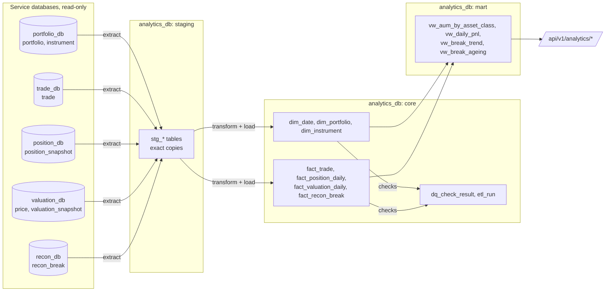

# Analytics Data Lineage (Phase 7)

> Where every warehouse column comes from. The ETL is `analyticsEtlJob` in analytics-service
> (`Extractor` → `Loader` → `DataQualityChecker`), run nightly at 02:00 IST for the previous day, or on request
> (`POST /api/v1/analytics/etl-runs?date=&fullRefresh=`, Admin).

## Flow

## Extract scope

| Staging table | Source | Incremental run for day D | Full refresh up to D |
|---|---|---|---|
| `stg_portfolio` | `portfolio_db.portfolio` | all rows | all rows |
| `stg_instrument` | `portfolio_db.instrument` | all rows | all rows |
| `stg_trade` | `trade_db.trade` | trade date D, or changed on D (IST) | trade date ≤ D |
| `stg_position_snapshot` | `position_db.position_snapshot` | snapshot date D | snapshot date ≤ D |
| `stg_price` | `valuation_db.price` | one price per instrument and data date ≤ D (real source preferred over a synthetic mark) | same |
| `stg_valuation_snapshot` | `valuation_db.valuation_snapshot` | as-of date D | as-of date ≤ D |
| `stg_recon_break` | `recon_db.recon_break` | raised or changed on D (IST) | raised ≤ D |

## Core tables

| Table (grain) | Column | Derived from |
|---|---|---|
| `dim_date` (day) | all | Generated in the migration, 2020–2035; `date_key` = yyyymmdd |
| `dim_portfolio` (portfolio) | `portfolio_id`, `name`, `base_currency`, `status` | `portfolio`; SCD type 1. Key -1 = Unknown |
| `dim_instrument` (instrument) | `instrument_id`, `isin`, `symbol`, `exchange`, `instrument_type`, `asset_class`, `is_synthetic` | `instrument`; SCD type 1. Key -1 = Unknown |
| `fact_trade` (trade, latest state) | `date_key`, `settle_date_key` | `trade.trade_date`, `trade.settle_date` |
| | `notional` | `round(quantity × price, 2)` |
| | `instrument_key` | -1 when the trade has no instrument (rejected: unknown ISIN) |
| | `status` | `trade.status`, overwritten as the trade settles or is cancelled |
| `fact_position_daily` (portfolio × instrument × day) | `quantity`, `avg_cost`, `realized_pnl` | `position_snapshot` |
| | `price`, `price_date` | Latest `stg_price` on or before the snapshot date (null if none: unpriced) |
| | `cost` | `round(quantity × avg_cost, 2)` |
| | `market_value` | `round(quantity × price, 2)` |
| | `unrealized_pnl` | `market_value − cost` |
| `fact_valuation_daily` (portfolio × day) | all measures, incl. `cash_balance`, `total_liabilities`, `nav`, `valuation_basis` | `valuation_snapshot` (end-of-day; NAV = market value + cash − liabilities, Phase 4B) |
| `fact_recon_break` (break, latest state) | `date_key`, `resolved_date_key` | `recon_break.created_at`, `resolved_at`, as IST dates |
| | `age_days` | Resolved: resolved date − raised date. Open: run date − raised date, recomputed for every open break on each run |

## Mart views

| View | Built from | Logic |
|---|---|---|
| `vw_aum_by_asset_class` | `fact_position_daily` × `dim_instrument` × `dim_date` | Sum of market value per day and asset class (open, priced positions), and its share of the day's total |
| `vw_daily_pnl` | `fact_valuation_daily` × `dim_portfolio` | Realized + unrealized = total P&L; daily P&L = change in total P&L from the portfolio's previous snapshot |
| `vw_break_trend` | `fact_recon_break` × `dim_date` | Per day and break type: raised, resolved, and open at the end of the day |
| `vw_break_ageing` | `fact_recon_break` | Unresolved breaks by type and age bucket (0-1, 2-3, 4-7, 8-14, 15+ days) |

## Data-quality checks (`core.dq_check_result`)

| Category | Checks | Severity |
|---|---|---|
| Row count | Staged rows = rows loaded, for trades, position days, valuation days, breaks | Critical |
| Not null | NAV present on every `FULL_NAV` valuation | Critical |
| | Open positions with no price | Warning |
| Uniqueness | Trade IDs in staging; trade references; ISINs in `dim_instrument` | Critical |
| Referential | Every fact key exists in its dimension (no foreign keys enforce this) | Critical |
| | Facts on the Unknown member | Warning |
| Sanity | Market value and quantity ≥ 0; trade quantity and price > 0; nothing dated after today | Critical |
| | Negative NAV (allowed: liabilities above assets) | Info |
| Freshness | A weekday without a valuation snapshot (expected on an NSE holiday) | Warning |

A failed critical check fails the job (`etl_run.status = FAILED`, with the check names in `message`). The results are
written in their own transaction, so they remain visible after a failed run.

## Idempotency

Every run can be repeated with the same result: staging is truncated first; dimensions are upserted; daily facts are
deleted for the days in scope and inserted again; trades and breaks are upserted by ID. Each run gets its own
`etl_run` row and Spring Batch job instance (`etlRunId` parameter), so the same date can run any number of times.
