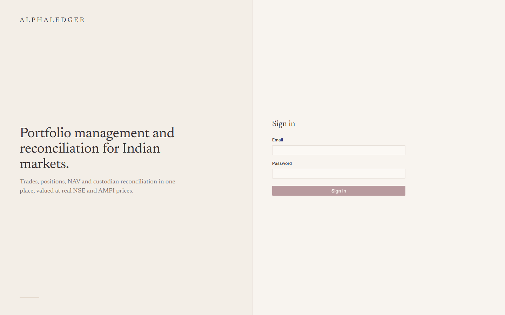
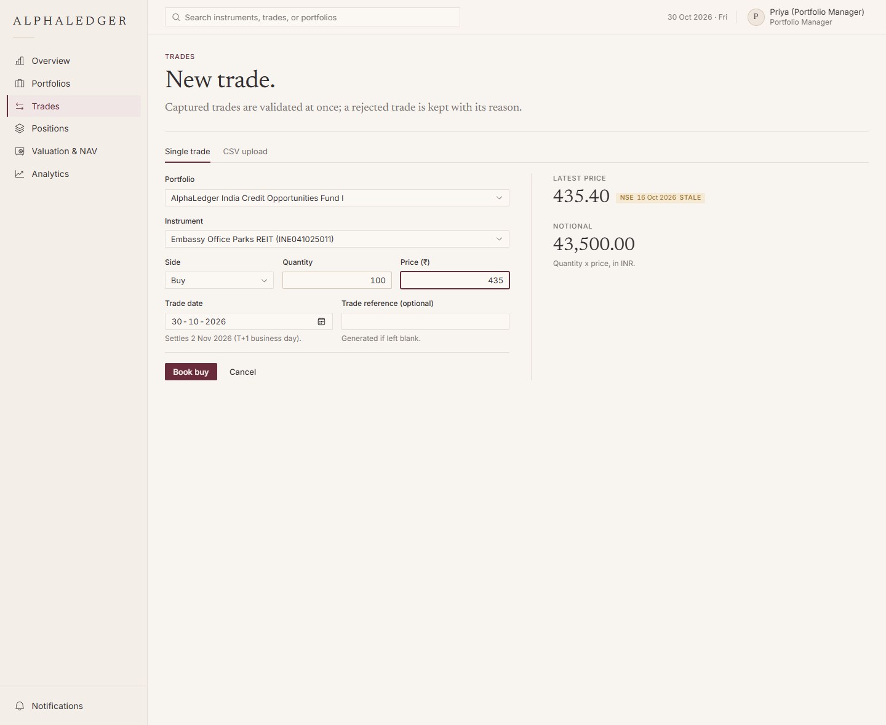
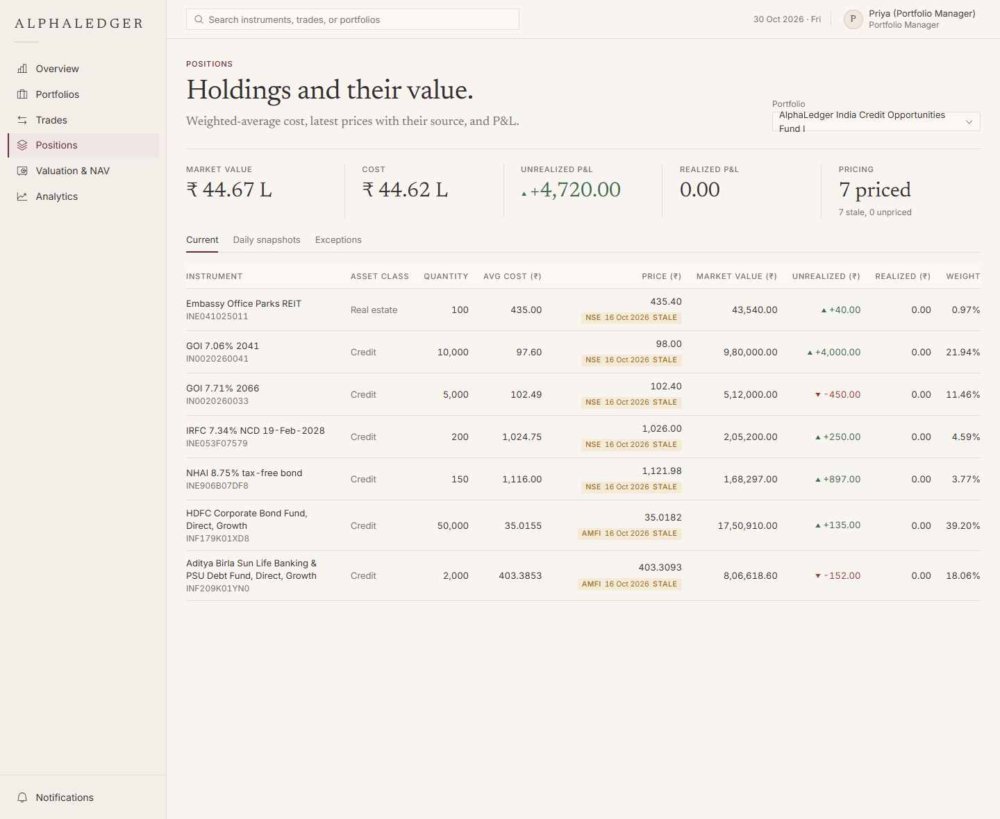
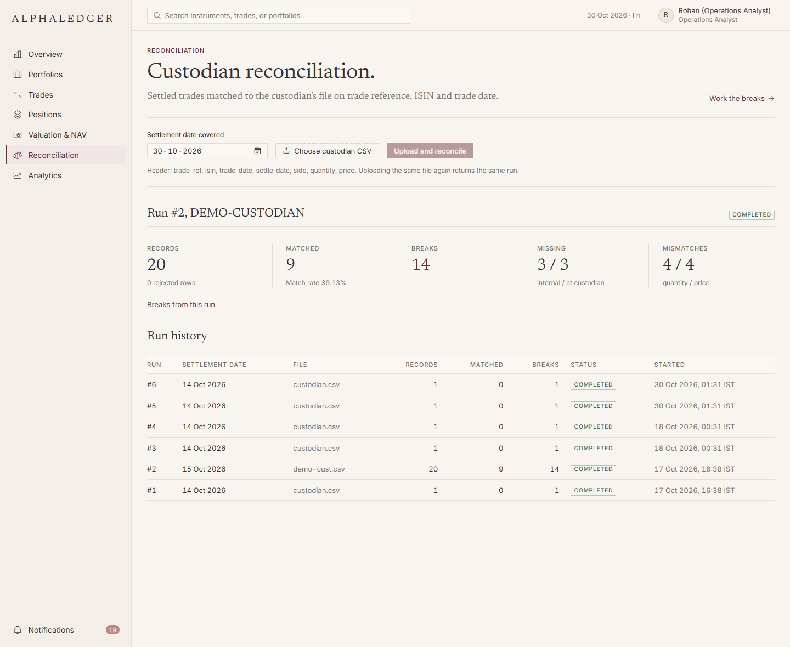
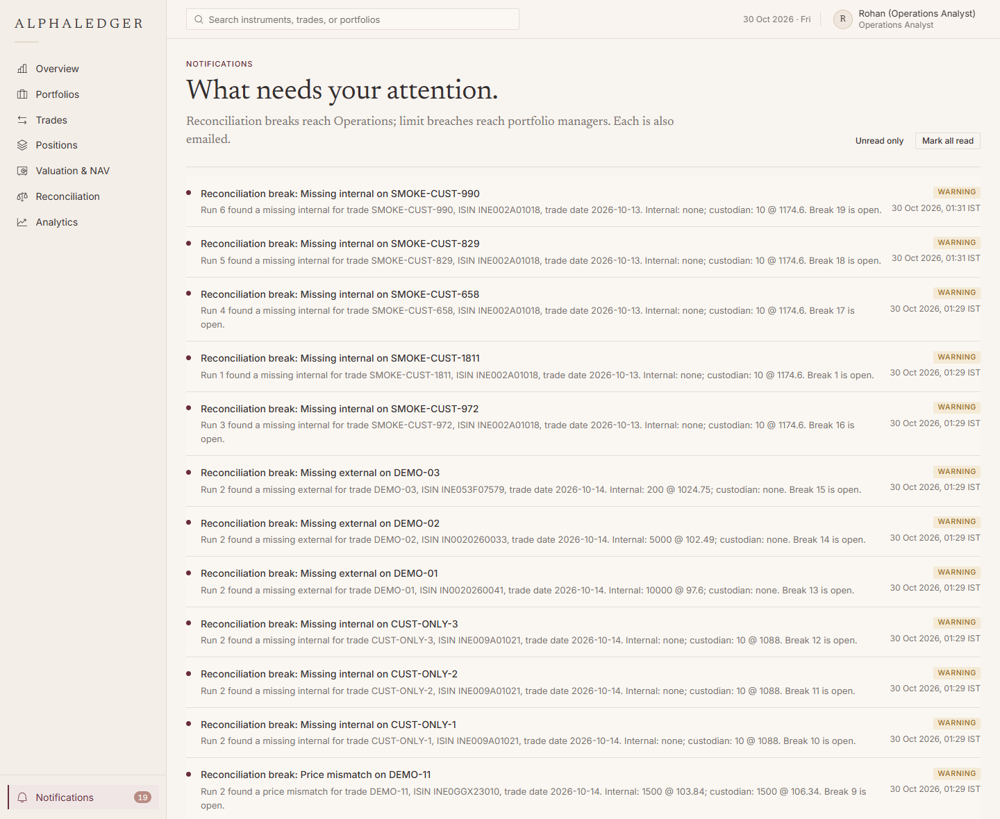
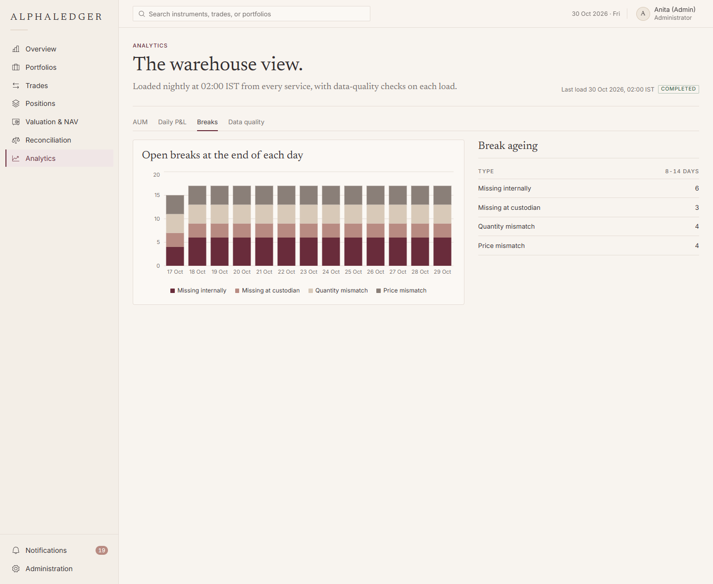
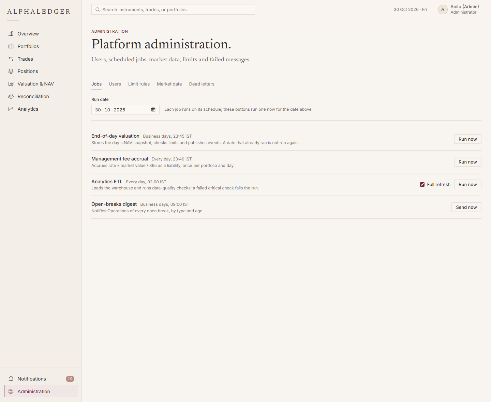

# Manual test guide: dashboard and backend together

A step-by-step check that the website and the backend work together locally. About 20 minutes.

All demo users share the password **`Demo@AlphaLedger2026`**.

| User | Role | What they can do |
|---|---|---|
| `priya.pm@alphaledger.test` | Portfolio Manager | Book and cancel trades |
| `rohan.ops@alphaledger.test` | Operations Analyst | Cash, liabilities, reconciliation |
| `anita.admin@alphaledger.test` | Administrator | Everything, including Administration |
| `vikram.auditor@alphaledger.test` | Auditor | Read only |

On the login page (development build) you can also click a demo user to fill in the form.

---

## 1. Start everything

Docker Desktop must be running. From the project folder:

```bash
docker compose -f infra/docker-compose.yml up -d --build
```

The first build takes several minutes. Wait until every service shows `healthy`:

```bash
docker compose -f infra/docker-compose.yml ps
```

Optional, recommended: run the automated end-to-end check. Every line should say `PASS`.

```bash
bash scripts/smoke-test.sh
```

Then open **http://localhost:3000**.

## 2. Sign in and out

1. You land on the login page. Sign in as **Priya**.
2. You see **"Your portfolios, at a glance."** with NAV, market value, cash, liabilities and P&L.
3. Reload the page (F5). You stay signed in: the session is restored from the secure cookie.
4. Open your name (top right) and **Sign out**. You return to the login page.
5. Try a wrong password: you see "Email or password is incorrect."

## 3. Load demo trades (one time)

In a terminal:

```bash
bash scripts/demo-trades.sh
```

This books 20 trades on 14-Oct-2026 at real closing prices across the three demo portfolios. Running it again
changes nothing.

## 4. Trades, positions and value (as Priya)

1. **Trades**: the blotter lists the demo trades. Try the filters (status, side, portfolio); the URL keeps them.
2. Click a trade to see its details and **status history**.
3. **New trade**: pick the *Bharat Real Assets Fund*, instrument *Embassy Office Parks REIT*, side Buy,
   quantity 100, price 435. Check the right-hand side shows the **latest price with its source** (NSE) and the
   notional, and that the trade date shows the T+1 settle date. Click **Book buy**.
4. You land on the new trade, status VALIDATED. Within a few seconds:
   - **Positions** (same portfolio): Embassy's quantity has gone up by 100, and every price shows its source badge
     (amber "stale" if it is older than the last business day).
   - **Overview**: market value and NAV have changed.
5. Try a rejected trade: **New trade**, Sell 999999 units of something you hold. The form shows it as
   **rejected with the reason** (it is still kept in the blotter).

## 5. Cash and liabilities (as Rohan)

1. Sign out, sign in as **Rohan**. Go to **Valuation & NAV**, portfolio *Bharat Real Assets Fund*.
2. You see the equation **Market value + Cash − Liabilities = NAV**.
3. **Cash** tab, **Deposit** 500000. The balance and NAV go up.
4. **Withdraw** more than the balance: the dialog shows the refusal from the server.
5. **Liabilities** tab, **Add liability**: Expense, "Custody fee", 2500. NAV goes down by 2,500.
6. Click **Pay** on it. It moves to PAID, cash goes down by 2,500, and **NAV stays the same**.

## 6. Reconciliation (as Rohan)

1. Make the custodian file for 15-Oct (the demo trades settle that day):

   ```bash
   python scripts/generate-custodian-file.py
   ```

   This writes `custodian-2026-10-15.csv`.
2. **Reconciliation**: set the settlement date to **15 Oct 2026**, choose the CSV, **Upload and reconcile**.
3. The run summary shows **3 missing internally, 3 missing at the custodian, 4 quantity and 4 price** breaks.
4. Upload the same file again: you are told it was already reconciled (same run).
5. **Work the breaks**: open a quantity mismatch. Internal and custodian values sit side by side, with the
   difference in red.
6. **Assign** (comment required). Then **Resolve** with "Adjust internal record" and a comment. The status becomes
   RESOLVED and the **audit trail** lists both actions.

## 7. Notifications

1. Still as Rohan, the **Notifications** item in the sidebar shows an unread count (one per break).
2. Open **Notifications**, click one: it marks it read and opens that break.
3. Emails: open **http://localhost:8025** (MailHog) to see the break emails sent to Rohan.

## 8. Analytics and administration (as Anita)

1. Sign in as **Anita**. **Administration > Jobs**: run **End-of-day valuation** for today, then **Analytics ETL**
   with *Full refresh* ticked. Both report success.
2. **Analytics**: AUM by asset class, daily P&L, the break trend and ageing, and **Data quality** (checks passed).
3. **Administration > Dead letters**: normally empty, which means no failed messages.
4. **Administration > Limit rules**: add Real estate, max 50% for every portfolio. Run End-of-day valuation for
   another date; Priya then gets a **limit breach** notification.

## 9. Roles and read-only access

1. Sign in as **Vikram** (Auditor). You can open trades, positions, valuation and breaks, but there is **no New
   trade button, no Deposit/Withdraw, and no break actions**.
2. Sign in as **Priya** and type `localhost:3000/recon` in the address bar: you are sent back to the overview
   (PMs have no reconciliation access) and the menu has no Reconciliation item.

## 10. Stop

```bash
docker compose -f infra/docker-compose.yml down        # keeps the data
docker compose -f infra/docker-compose.yml down -v     # also deletes the database (fresh start next time)
```

---

## Screenshots

Captured from the running stack with the demo data (30 Oct 2026). The numbers are live API values.

**Login.** Four roles; development builds offer one-click demo users.



**Overview (Priya).** NAV, market value, cash, liabilities and P&L summed across the portfolios she can see; AUM by
asset class from real exposure; recent trades, including rejected ones; and live status strips at the bottom (limit
breaches, pending settlements, the latest ETL run).


**Trade blotter (Priya).** Every trade with its status and settle date; filters are kept in the URL.


**New trade (Priya).** The latest price with its source and date (stale prices flagged), the notional, and the T+1
settle date computed on the NSE holiday calendar.



**Positions (Priya).** Holdings at weighted-average cost, valued at the latest price, each with its source badge
(NSE bhavcopy or AMFI NAV), and unrealized and realized P&L.



**Valuation & NAV (Rohan).** The NAV equation, market value + cash - liabilities, and exposure by asset class
against limits.


**Reconciliation run (Rohan).** The custodian file's summary: matched trades, match rate and the four break types.



**Break detail (Rohan).** Our books against the custodian's file, with the difference in red, the SLA flag, the
actions available for the break's state, and its audit trail.


**Notifications (Rohan).** Breaks reach Operations in the app (and by email), with per-user read state.



**Analytics (Anita).** The warehouse view: open breaks at the end of each day by type, and break ageing.



**Administration (Anita).** Run the scheduled jobs on demand: end-of-day valuation, fee accrual, the analytics ETL
and the open-breaks digest.



---

## Presenting the walkthrough

A talk track for showing the flow above to someone else (an interviewer, a reviewer). Each step has what to say,
what it proves, and what happens underneath, so you can go as deep as the audience wants.

### The one-minute framing (say this first)

> "AlphaLedger is the back office of an asset manager. Every day a fund has to do three things: **record its
> trades**, **know what it holds and what that is worth**, and **prove its records match the custodian's**, the bank
> that actually holds the securities. I built that as event-driven microservices: eleven Spring Boot services, Kafka
> between them, a database per service, and a React dashboard on top. Prices are real NSE and AMFI closes; trades
> and custodian files are synthetic. I'll walk one trade from booking to reconciliation, and show what keeps it
> correct when things go wrong."

### Step by step

**Sign in (step 2)**
- *Say:* "Four roles: portfolio manager, operations analyst, admin and auditor. Each sees only what it should."
- *Proves:* authentication and role-based access, and a session that survives a reload without the browser ever
  holding the long-lived credential.
- *Underneath:* auth-service issues a 15-minute JWT access token, kept only in memory, and a 7-day refresh token that
  lives only in an `HttpOnly; SameSite=Strict` cookie, so script on the page can never read it. On reload the app
  calls `/refresh`; the token is rotated on every use under a database row lock, and reusing an old one revokes every
  session of that user. Tabs coordinate through the Web Locks API so two tabs never refresh at once. The gateway
  checks the JWT, and every service checks it again (defence in depth).

**Book a trade (step 4)**
- *Say:* "Priya buys 100 Embassy REIT units. Notice the latest price shows where it came from and how old it is, and
  the settle date skips weekends and NSE holidays."
- *Proves:* validated trade capture with T+1 settlement on the real NSE calendar, and data provenance on every price.
- *Underneath:* trade-service validates the request (ISIN check digit, business day, holding check under a Postgres
  advisory lock so two simultaneous SELLs cannot both pass) and calls portfolio-service through a retry and circuit
  breaker. The trade row and its `trade.created` event are written in **one transaction** (transactional outbox); a
  relay then publishes to Kafka. So an event is never lost, and never sent for a trade that rolled back.

**Positions and NAV update by themselves (step 4)**
- *Say:* "I didn't refresh anything. The position and the NAV moved within seconds."
- *Proves:* an event-driven pipeline: trade, then position, then valuation, with no service calling another.
- *Underneath:* position-service consumes `trade.created`, rebuilds the holding from all its trades (weighted-average
  cost, realised P&L, exact cancels) and publishes `position.updated`. valuation-service consumes that and values it
  at the latest price. Consumers are idempotent: each records the event ID it processed, so Kafka's at-least-once
  redelivery can never double-count.

**A rejected trade (step 4)**
- *Say:* "Selling more than we hold is rejected, and still recorded."
- *Proves:* business rules enforced server-side, and a complete audit trail (rejections are kept, as in real trade
  capture).

**Cash, liabilities, NAV (step 5)**
- *Say:* "Market value is not NAV. NAV is market value plus cash minus liabilities. Paying a bill moves money from
  cash to settle a liability, so NAV doesn't change."
- *Proves:* a defensible NAV, and accounting that balances.
- *Underneath:* cash is an append-only ledger (a database trigger refuses updates and deletes), so any past date can
  be rebuilt. A settled trade moves cash on its settle date via the `trade.settled` event. A daily job accrues the
  management fee (`rate x market value / 365`). The withdrawal refusal comes from the server, not the UI.

**Reconciliation (step 6)**
- *Say:* "This is the core of operations. The custodian sends a file; we match it to our settled trades and get
  three kinds of difference: trades missing on either side, and quantity or price mismatches."
- *Proves:* a batch matching engine, idempotent file intake, and a controlled break workflow with an audit trail.
- *Underneath:* a Spring Batch job stages and validates rows (bad rows are reported, not dropped), then matches in
  memory on `trade ref + ISIN + trade date`; 10,000 rows reconcile in under 30 seconds. A SHA-256 checksum makes a
  re-upload return the same run. Each break moves OPEN, IN_REVIEW, then ESCALATED or RESOLVED; every action needs a
  comment and writes an immutable before/after audit record.

**Notifications (step 7)**
- *Say:* "Each break reached Ops in the app and by email, without the reconciliation service knowing anything about
  notifications."
- *Proves:* loose coupling through events, and resilience.
- *Underneath:* notification-service consumes `recon.break.created`. Emails are queued in its database and sent by a
  poller, so a mail outage delays emails but never loses a notification. Every Kafka consumer retries with backoff
  and then moves a failing message to a dead-letter topic, so one bad message never blocks the rest.

**Analytics and admin (step 8)**
- *Say:* "Overnight, an ETL loads a small data warehouse from every service and checks the data before anyone
  reports on it."
- *Proves:* data engineering: a star schema, incremental and repeatable loads, and data-quality gates.
- *Underneath:* a Spring Batch job extracts from each service's database (read-only) into staging, loads dimensions
  and facts, then runs 20+ checks: row counts, nulls, uniqueness, broken references, and sanity (no negative market
  value, nothing dated in the future). A failed critical check fails the run. The admin screen also shows dead
  letters, with a replay once the cause is fixed.

**Roles (step 9)**
- *Say:* "The auditor can see everything and change nothing. The portfolio manager can't even open reconciliation."
- *Proves:* least privilege, enforced twice: the UI hides what a role can't do, and the services refuse it anyway.

### Closing line

> "So the walkthrough proves the three jobs work end to end: trades are captured correctly, holdings and NAV stay
> accurate automatically, and our books are reconciled against the custodian, with the safety nets that keep it
> correct under failure: transactional outbox, idempotent consumers, retries and dead letters, and audit trails."

## Technical background

### Architecture in one picture

```
Browser (React, :3000) ──/api──> nginx ──> API gateway (JWT, routing, circuit breakers, rate limit)
                                              │
        ┌──────────────┬──────────────┬───────┴──────┬──────────────┬───────────────┐
   auth-service  portfolio-service  trade-service  position-svc  valuation-svc  reconciliation-svc
        │               │                │              │              │               │
     auth_db      portfolio_db       trade_db      position_db   valuation_db       recon_db
                                         │  outbox      ▲   │          ▲   │            │
                                         └──> Kafka ────┘   └──> Kafka ┘   └─> Kafka ───┘
                                                    │
                                     notification-service (in-app + email)   analytics-service (nightly ETL)
```

### The events behind the flow

| Topic | Published by | Consumed by | Why |
|---|---|---|---|
| `trade.created` / `trade.cancelled` | trade-service | position-service | Rebuild holdings |
| `position.updated` | position-service | valuation-service | Revalue the portfolio |
| `trade.settled` | trade-service | valuation-service, reconciliation-service | Move cash; feed matching |
| `valuation.calculated`, `limit.breached` | valuation-service | notification-service, analytics | Snapshots and alerts |
| `recon.break.created` / `resolved` | reconciliation-service | notification-service | Alert Ops; digest |

### Reliability patterns you can point at

| Pattern | Where you see it in the demo |
|---|---|
| Transactional outbox | A booked trade always reaches positions; nothing is published for a failed one |
| Idempotent consumers | Re-delivered events never double a position |
| Retry, then dead-letter | Administration > Dead letters (empty when healthy) |
| Circuit breaker | A stopped service shows "temporarily unavailable" at once instead of hanging |
| Idempotent file intake | Uploading the same custodian file returns the same run |
| Audit trails | Trade status history; break audit trail |
| Correlation IDs | The "Reference" on an error toast traces one request across services and Kafka |

### Tech stack

Java 21, Spring Boot 4, Spring Cloud (Gateway, Eureka, Config), Spring Kafka, Spring Batch, PostgreSQL 16 with
Flyway, Kafka 4.2, Resilience4j; React 19, TypeScript, Vite, Tailwind CSS, TanStack Query and Table, Radix; Docker
Compose. Tested with JUnit 5 and Testcontainers (real Postgres and Kafka) on the backend, Vitest and Testing Library
on the frontend, and a 62-check smoke test against the running stack.

### Likely questions and short answers

| Question | Answer |
|---|---|
| Why Kafka instead of REST between services? | Services stay independent: trade-service doesn't know positions or recon exist. Events can be replayed, and a slow consumer never slows trade capture |
| How do you avoid losing or double-counting events? | Outbox on the producer side (atomic with the data), idempotent consumers on the other, dead letters for poison messages |
| Why is NAV different from market value? | NAV includes cash and liabilities; market value is only the holdings |
| What makes reconciliation trustworthy? | Deterministic matching keys, every break type covered, checksum-idempotent intake, and an immutable audit of every action |
| How is the refresh token protected? | It is an HttpOnly, SameSite=Strict cookie scoped to the auth endpoints, rotated on every use, with reuse detection |
| What would you add for production? | CI/CD with coverage gates, Prometheus and Grafana, read replicas or CDC for the ETL, and HTTPS everywhere |

---

### If something looks wrong

| Symptom | Check |
|---|---|
| Login page keeps returning | `docker compose ... ps`: is `auth-service` healthy? |
| A screen says "temporarily unavailable" | That service is still starting or stopped; wait, then **Try again** |
| Positions do not change after a trade | Kafka and position-service must be healthy; they update within seconds |
| No value chart on the overview | Normal at first: it needs two end-of-day snapshots (run End-of-day valuation as Anita for two dates) |
| Error toast with a "Reference" | Copy it; it is the correlation ID to search for in the service logs (`docker compose ... logs <service>`) |
